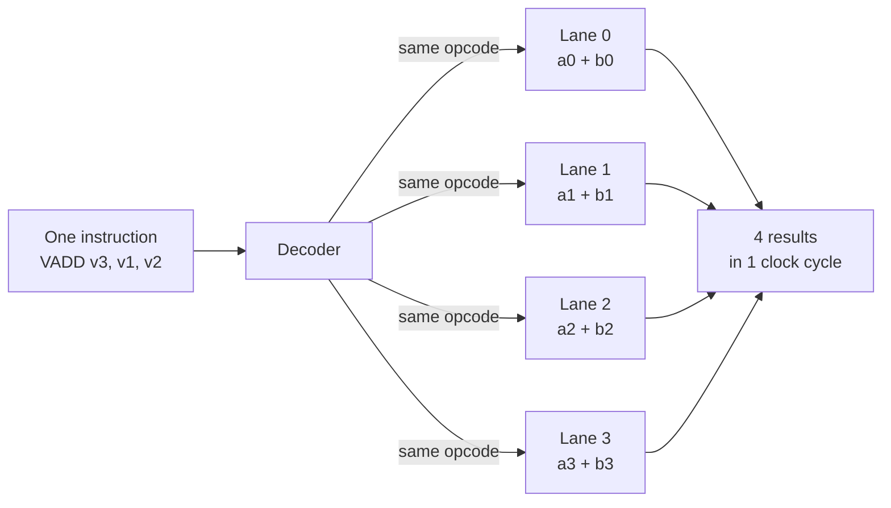
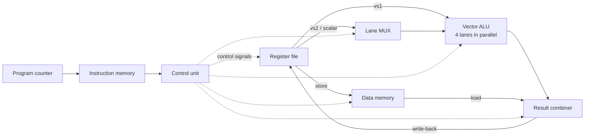
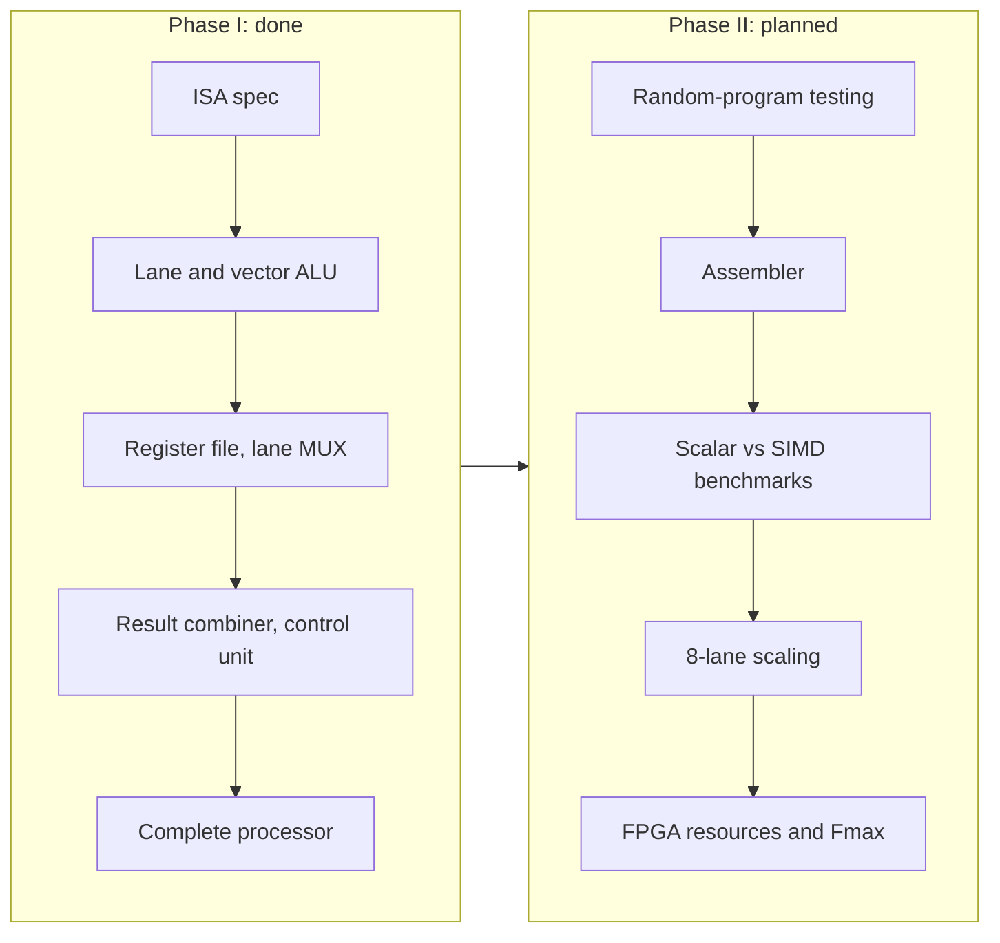

# SIMD Vector Processing Unit

A small **SIMD (Single Instruction, Multiple Data) processor** written in Verilog. One instruction performs the same operation on **4 data elements at once** (or 8, or 1, set by a parameter). The 1-lane build is an ordinary scalar processor with the same instruction set, so scalar and SIMD versions can be compared fairly.

Course project 11, Master of Computer Applications, Semester V. Phase I.



## At a glance

| | |
|---|---|
| **Lanes** | 4 by default; 1, 4 or 8 via the `LANES` parameter |
| **Lane width** | 8 bits by default; any power of two via `WIDTH` |
| **Instructions** | 16 instructions of 16 bits: add, subtract, AND, OR, XOR, compare, shift, multiply, load, store, scalar broadcast, halt |
| **Registers** | 8 vector registers + 1 scalar register |
| **Execution** | one instruction per clock cycle |
| **Verification** | 9 self-checking testbenches, 825,600 checks, all passing; 23 of 23 planted bugs caught |
| **Tools** | Icarus Verilog, Yosys, VS Code + WaveTrace |

## How it works



Each cycle the processor fetches an instruction, decodes it, reads two vector registers, runs all lanes at once, and writes the result back. Details: [docs/architecture.md](docs/architecture.md).

## Quick start

```bash
brew install icarus-verilog yosys      # Ubuntu/WSL: sudo apt install iverilog yosys

make all_tests              # run every testbench (4 lanes x 8 bits)
make all_tests LANES=8      # 8 lanes
make all_tests LANES=1      # scalar baseline
make demo                   # run the example programs in programs/
make synth LANES=4          # synthesis report -> results/synth_L4_W8.txt
```

Each test ends with `ALL PASS` or `FAILED with N errors`. Waveforms are saved as `sim/tb_<name>_L<lanes>_W<width>.vcd`. More: [docs/getting_started.md](docs/getting_started.md).

## Documentation

| Topic | File |
|---|---|
| Documentation index and reading order | [docs/README.md](docs/README.md) |
| What SIMD is, lanes, vectors, speedup | [docs/simd_concepts.md](docs/simd_concepts.md) |
| Install, run tests, waveforms, troubleshooting | [docs/getting_started.md](docs/getting_started.md) |
| Block diagram and one clock cycle | [docs/architecture.md](docs/architecture.md) |
| All 16 instructions and their encodings | [docs/instruction_set.md](docs/instruction_set.md) |
| Lane ALU, vector ALU, register file, lane MUX, result combiner | [docs/datapath_modules.md](docs/datapath_modules.md) |
| Instruction decoder | [docs/control_unit.md](docs/control_unit.md) |
| Complete processor: memories, PC, HALT, counters | [docs/top_level_processor.md](docs/top_level_processor.md) |
| Writing and running programs | [docs/programming_guide.md](docs/programming_guide.md) |
| How it was tested and the results | [docs/verification.md](docs/verification.md) |
| Hardware cost and performance measurement | [docs/synthesis_and_performance.md](docs/synthesis_and_performance.md) |
| IEEE report | [docs/report/main.pdf](docs/report/main.pdf) |
| Demo video | _link to be added_ |

## Repository layout

```
SIMD/
├── Makefile              build, test and synthesis commands
├── rtl/                  hardware design (Verilog)
│   ├── simd_defs.vh      opcodes and instruction fields, shared by every file
│   ├── lane_alu.v        one lane
│   ├── vector_alu.v      LANES lanes side by side
│   ├── vector_regfile.v  8 vector registers + scalar register
│   ├── lane_mux.v        operand B: vector or broadcast scalar
│   ├── result_combiner.v write-back select and mask summary
│   ├── vector_control.v  instruction decoder
│   └── simd_top.v        the complete processor
├── tb/                   self-checking testbenches, one per module
├── sim/                  simulation outputs (not in git)
├── results/              synthesis reports
├── programs/             example programs (hex) and their runner; assembler in Phase II
└── docs/                 documentation and the IEEE report
```

## Status



## Team

Every row matches the commit history (`git shortlog -sn`) and Section IV / Fig. 5 of the [IEEE report](docs/report/main.pdf).

| Member | GitHub | Files and work |
|---|---|---|
| Nipun Patlori | `nipun1803` | Datapath RTL: `simd_defs.vh` (ISA definitions), `lane_alu.v`, `lane_mux.v`, `vector_alu.v`, `result_combiner.v` |
| Mohan Kumar C R | `mohan101mk` | Storage, control and integration RTL: `vector_regfile.v`, `vector_control.v`, `simd_top.v` |
| Anushka Tyagi | `anu-ushka` | Verification: `tb_defs.v`, `ref_alu.vh` reference model and all nine testbenches in `tb/` |
| Omkar Hadole | `omkar-hadole` | Scaffolding and `Makefile`, synthesis report, all of `docs/`, this README, IEEE report text and references |
| Saksham Sharma | `Saksham-9898` | IEEE report figures 1–5 (colour diagrams), README / report / Git consistency review, example programs in `programs/` with `make demo` |
