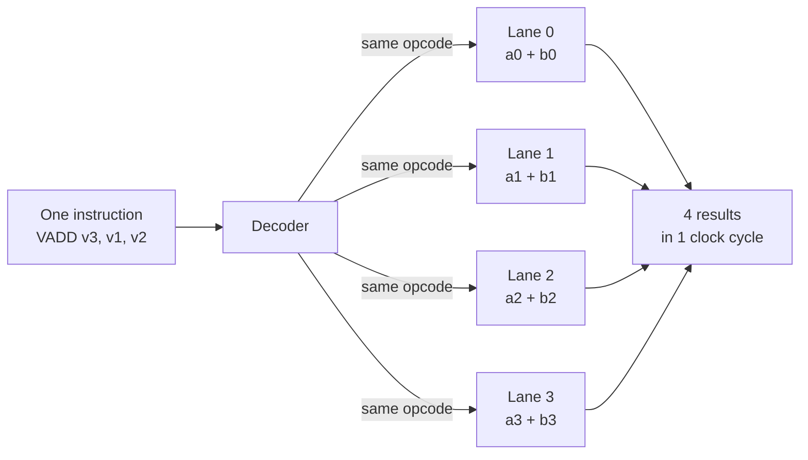
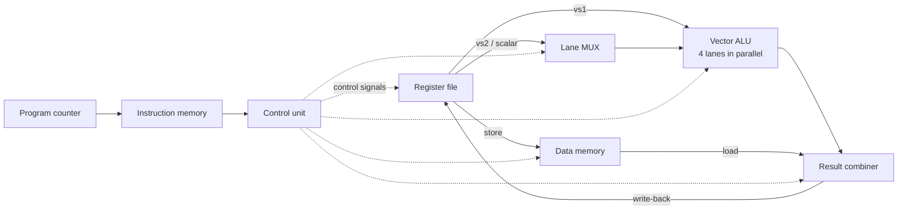
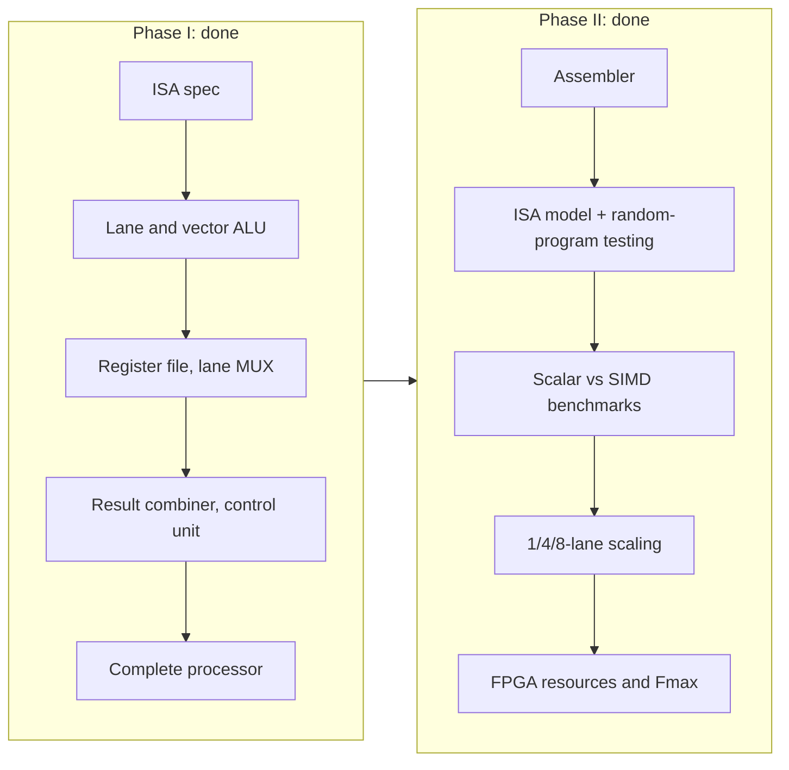

# SIMD Vector Processing Unit

A small **SIMD (Single Instruction, Multiple Data) processor** written in Verilog. One instruction performs the same operation on **4 data elements at once** (or 8, or 1, set by a parameter). The 1-lane build is an ordinary scalar processor with the same instruction set, so scalar and SIMD versions can be compared fairly.

Course project 11, Modern Computer Architecture, Semester V. Phase II (final).

> 📹 **Demo Video:** [Watch the Prototype Demonstration on Google Drive](https://drive.google.com/drive/folders/17inRVThPM6PJx6WKdC6LPiTfmpqH07jN)



## At a glance

| | |
|---|---|
| **Lanes** | 4 by default; 1, 4 or 8 via the `LANES` parameter |
| **Lane width** | 8 bits by default; supported `WIDTH` values: 2, 4, 8 and 16 |
| **Instructions** | 16 instructions of 16 bits: add, subtract, AND, OR, XOR, compare, shift, multiply, load, store, scalar broadcast, halt |
| **Registers** | 8 vector registers + 1 scalar register |
| **Execution** | one instruction per clock cycle |
| **Verification** | 9 self-checking testbenches, 826,122 default-configuration checks, all passing; 23 of 23 planted bugs caught; 12,000 random programs vs an independent ISA model, 0 mismatches |
| **Speedup (N = 32)** | 4 lanes: 3.67–3.94× fewer cycles; 8 lanes: 6.60–7.72× fewer cycles than the 1-lane build |
| **FPGA (Lattice ECP5-85F)** | 2,200 → 7,606 → 13,261 logic cells and 60.1 → 55.5 → 52.1 MHz for 1 → 4 → 8 lanes; array add runs 6.58× faster in time on 8 lanes |
| **Tools** | Icarus Verilog, Yosys, Python 3.9+ (assembler, ISA model, evidence), OSS CAD Suite (nextpnr-ecp5) for FPGA results, Tectonic for the report, VS Code + WaveTrace |

## How it works



Each cycle the processor fetches an instruction, decodes it, reads two vector registers, runs all lanes at once, and writes the result back. Details: [docs/architecture.md](docs/architecture.md).

## Quick start

```bash
brew install icarus-verilog yosys      # Ubuntu/WSL: sudo apt install iverilog yosys

make all_tests              # run every testbench (4 lanes x 8 bits)
make all_tests LANES=8      # 8 lanes
make all_tests LANES=1      # scalar baseline
make verify_matrix          # complete logs for all 12 supported configurations
make mutation_tests         # 23 seeded RTL faults and 6 coverage-guard probes
make asm_test               # assembler self-checks (all 65,536 instruction words)
make model_test             # Python ISA model tests + RTL-vs-model check on all 12 builds
make run_prog PROG=programs/add.s   # run any program on the RTL and the model, compare
make random_tests           # 1,000 random programs x 12 builds, RTL vs ISA model
make bench                  # scalar vs SIMD benchmarks (1, 4, 8 lanes) -> results/bench.txt
make demo                   # assemble and run the example programs in programs/
make synth LANES=4          # synthesis report -> results/synth_L4_W8.txt
make synth_scaling          # generic synthesis for 1, 4, 8 lanes -> results/synth_scaling.csv
make fpga                   # ECP5 place & route + Fmax, 1/4/8 lanes (needs OSS CAD Suite)
```

Synthesis uses `synthesis/simd_synth_top.v` with variable instruction inputs. Its generic cell count includes the datapath, data memory, PC and counters; instruction ROM is excluded. The saved report includes the tool version, parameters, command and source hashes. See [docs/synthesis_and_performance.md](docs/synthesis_and_performance.md).

Each test ends with `ALL PASS` or `FAILED with N errors`. Waveforms are saved as `sim/tb_<name>_L<lanes>_W<width>.vcd`. More: [docs/getting_started.md](docs/getting_started.md).

The evidence runners use Python's standard library and temporary source copies. Saved reports include tool versions, commands and source hashes. The matrix tests all combinations of `LANES=1,4,8` and `WIDTH=2,4,8,16`; mutation definitions are in [scripts/mutation_cases.py](scripts/mutation_cases.py).

## Documentation

| Topic | File |
|---|---|
| Documentation index and reading order | [docs/README.md](docs/README.md) |
| What SIMD is, lanes, vectors, speedup | [docs/simd_concepts.md](docs/simd_concepts.md) |
| Install, run tests, waveforms, troubleshooting | [docs/getting_started.md](docs/getting_started.md) |
| Block diagram and one clock cycle | [docs/architecture.md](docs/architecture.md) |
| All 16 instructions and their encodings | [docs/instruction_set.md](docs/instruction_set.md) |
| Lane ALU, vector ALU, register file, lane MUX, result combiner | [docs/datapath_modules.md](docs/datapath_modules.md) |
| Instruction decoder | [docs/control_unit.md](docs/control_unit.md) |
| Complete processor: memories, PC, HALT, counters | [docs/top_level_processor.md](docs/top_level_processor.md) |
| Writing and running programs | [docs/programming_guide.md](docs/programming_guide.md) |
| How it was tested and the results | [docs/verification.md](docs/verification.md) |
| Hardware cost and performance measurement | [docs/synthesis_and_performance.md](docs/synthesis_and_performance.md) |
| IEEE report | [docs/report/main.pdf](docs/report/main.pdf) |
| Phase I report, frozen as submitted (16 Nov 2026) | [docs/report/phase1/main.pdf](docs/report/phase1/main.pdf) |
| Current complete verification matrix | [results/verification_matrix.txt](results/verification_matrix.txt) |
| RTL mutation evidence | [results/mutations.txt](results/mutations.txt) |
| Coverage-guard evidence | [results/coverage_guards.txt](results/coverage_guards.txt) |
| Random-program verification (12,000 programs, 0 mismatches) | [results/random_verification.txt](results/random_verification.txt) |
| Random programs against the planted bugs | [results/random_mutations.txt](results/random_mutations.txt) |
| Scalar-vs-SIMD benchmark results | [results/bench.txt](results/bench.txt), [results/bench.csv](results/bench.csv) |
| Generic synthesis scaling (1, 4, 8 lanes) | [results/synth_scaling.csv](results/synth_scaling.csv) |
| FPGA resources and Fmax (ECP5-85F) | [results/fpga_summary.csv](results/fpga_summary.csv), [results/fpga/](results/fpga/) |
| Historical tests and example-program evidence | [results/history/test_logs.txt](results/history/test_logs.txt) |
| Demo video | [Google Drive video](https://drive.google.com/drive/folders/17inRVThPM6PJx6WKdC6LPiTfmpqH07jN) |

## Repository layout

```
SIMD/
├── Makefile              build, test and synthesis commands
├── rtl/                  hardware design (Verilog)
│   ├── simd_defs.vh      opcodes and instruction fields, shared by every file
│   ├── lane_alu.v        one lane
│   ├── vector_alu.v      LANES lanes side by side
│   ├── vector_regfile.v  8 vector registers + scalar register
│   ├── lane_mux.v        operand B: vector or broadcast scalar
│   ├── result_combiner.v write-back select and mask summary
│   ├── vector_control.v  instruction decoder
│   └── simd_top.v        the complete processor
├── tb/                   self-checking testbenches, one per module, + prog_runner.v (runs programs, dumps state)
├── synthesis/            simd_synth_top.v (generic cells) and fpga_top.v (ECP5 resources and Fmax)
├── sim/                  simulation outputs (not in git)
├── results/              verification, benchmark, synthesis and FPGA evidence
├── scripts/              assembler (lfasm.py), ISA model (lfmodel.py), random verification, benchmarks,
│                         FPGA flow, report tables, mutation definitions, waveform renderer
├── programs/             example programs (.s + hex), their runner, and bench/ benchmark programs
└── docs/                 documentation and the IEEE report
```

## Status



## Team

Roles in both phases, as in Section V and Fig. 6 of the [IEEE report](docs/report/main.pdf).

| Member | GitHub | Phase I role | Phase II role |
|---|---|---|---|
| Nipun Patlori | `nipun1803` | Datapath designer: instruction-set definitions, lane ALU, vector ALU, lane multiplexer for the scalar broadcast, result combiner; simulation waveform figure and Phase I conclusion | Random-verification lead: independent instruction-set reference model, program runner, seeded random program generator with coverage goals, 12,000 random programs checked in all 12 configurations, random testing scored against the planted faults |
| Mohan Kumar C R | `mohan101mk` | Storage, control and integration designer: vector register file and scalar register, instruction decoder, complete single-cycle processor (memories, program counter, halt logic, performance counters, debug port); prototype video | FPGA implementation lead: Lattice ECP5 implementation for 1, 4 and 8 lanes, resource and maximum-frequency measurement, critical-path analysis, time speedup; final report integration (abstract, introduction, conclusion, results tables) |
| Anushka Tyagi | `anu-ushka` | Verification engineer: testbench infrastructure, independent ALU reference model, nine self-checking testbenches with exhaustive lane-ALU and decoder tests, lane isolation and whole-processor checks | Scaling-study lead: synthesis for 1, 4 and 8 lanes and per-block cost analysis; final runs of the verification matrix and planted-fault campaign; verification and hardware-cost results |
| Omkar Hadole | `omkar-hadole` | Build and documentation lead: project structure, build and simulation flow, first synthesis report, project documentation, Phase I report text and references | Software-tools lead: assembler with data placement, line-numbered errors, disassembler and tests over every instruction word; example programs in assembly; user documentation for the new tools |
| Saksham Sharma | `Saksham-9898` | Figures and review: report figures, README / report / repository consistency review, runnable example programs with a demo check | Performance-evaluation lead: four scalar-versus-SIMD benchmark kernels for 1, 4 and 8 lanes, checked against expected results, the reference model and predicted cycle counts; speedup analysis and chart |
