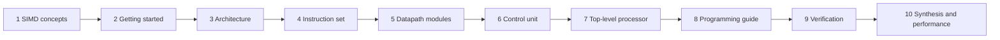

# Documentation

Start here. The files are ordered so that each one builds on the previous one. If you are new to the project, read them in this order.

| # | File | What it explains |
|---|---|---|
| 1 | [simd_concepts.md](simd_concepts.md) | What SIMD is, lanes and vectors, why lanes must be independent, how speedup is measured |
| 2 | [getting_started.md](getting_started.md) | Installing the tools, running the tests, viewing waveforms, running synthesis |
| 3 | [architecture.md](architecture.md) | The block diagram and what happens inside one clock cycle |
| 4 | [instruction_set.md](instruction_set.md) | Registers, instruction formats, all 16 instructions, encoding examples |
| 5 | [datapath_modules.md](datapath_modules.md) | Lane ALU, vector ALU, register file, lane MUX, result combiner |
| 6 | [control_unit.md](control_unit.md) | How the decoder turns an instruction into control signals |
| 7 | [top_level_processor.md](top_level_processor.md) | `simd_top`: memories, program counter, HALT, performance counters |
| 8 | [programming_guide.md](programming_guide.md) | Writing a program, loading it, running it and reading the results |
| 9 | [verification.md](verification.md) | How every module was tested, the results, and the planted-bug experiment |
| 10 | [synthesis_and_performance.md](synthesis_and_performance.md) | Hardware cost from synthesis, and how scalar vs. SIMD performance will be measured |

The formal write-up is the IEEE report: [report/main.pdf](report/main.pdf) (source: [report/main.tex](report/main.tex)).

