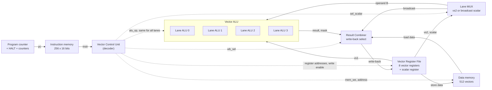
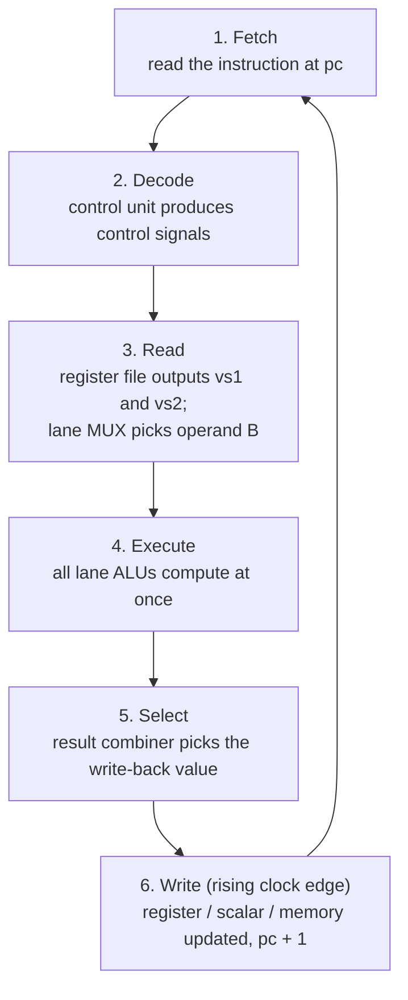
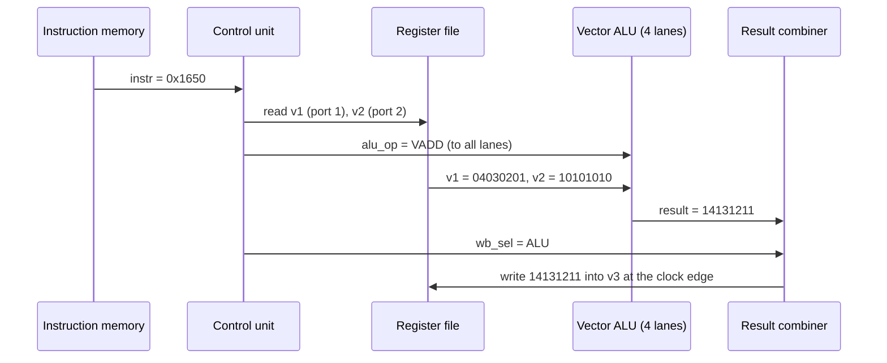

# Architecture

How the parts of the processor connect, and what happens in one clock cycle.

## Block diagram

Solid arrows carry data, dotted arrows carry control signals from the decoder.

| Block | File | Job |
|---|---|---|
| Program counter, HALT, counters | `rtl/simd_top.v` | chooses the next instruction, stops at HALT, counts cycles |
| Instruction memory | `rtl/simd_top.v` | holds the program (256 instructions) |
| Vector Control Unit | `rtl/vector_control.v` | decodes the instruction into control signals |
| Vector Register File | `rtl/vector_regfile.v` | 8 vector registers and 1 scalar register |
| Lane MUX | `rtl/lane_mux.v` | picks operand B: a vector register, or the scalar copied to every lane |
| Vector ALU | `rtl/vector_alu.v`, `rtl/lane_alu.v` | 4 lane ALUs working in parallel |
| Result Combiner | `rtl/result_combiner.v` | picks what is written back: ALU result, loaded data, or broadcast scalar |
| Data memory | `rtl/simd_top.v` | 512 words, each one whole vector |

## What happens in one clock cycle

Every instruction finishes in a single clock cycle.

Steps 1 to 5 are combinational: they settle within the clock period. Step 6 happens on the clock edge, so all state changes at the same moment.

## Example: one `VADD v3, v1, v2`

## Main design decisions

| Decision | Choice | Why |
|---|---|---|
| Lane count and width | parameters `LANES`, `WIDTH` on every module | one design gives the scalar, 4-lane and 8-lane versions |
| Execution | single-cycle (one instruction per cycle) | cycle counts equal instruction counts, so results are easy to check by hand |
| Where constants live | one header file, `rtl/simd_defs.vh` | every file uses the same opcodes and field positions |
| Memories | inside the processor top level | the design is self-contained; testbenches load programs directly |
| Decoding | only in the control unit | datapath blocks just follow control signals, so each block stays simple |
| Register reads during a write | return the old value | correct for a single-cycle design: `VADD v1, v1, v2` uses the old `v1` |
| After HALT | every write is blocked in one place | nothing can change once the program has stopped |

**Next:** [instruction_set.md](instruction_set.md)
