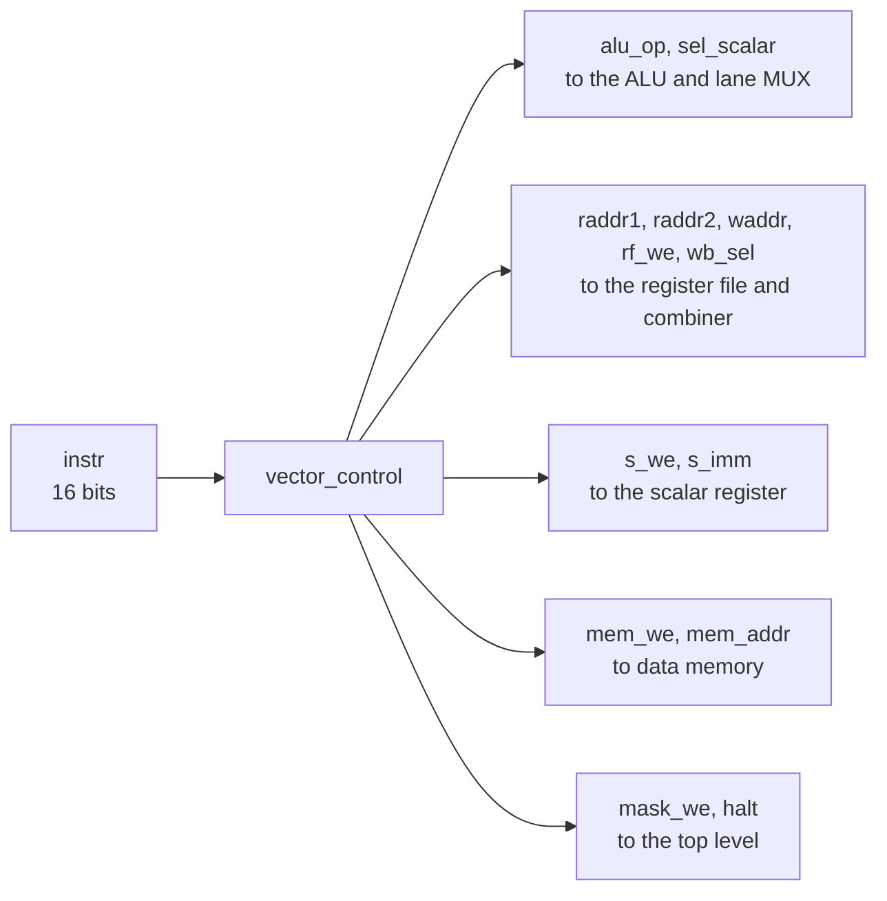

# Control Unit

**File:** [`rtl/vector_control.v`](../rtl/vector_control.v)

The control unit (decoder) reads one 16-bit instruction and produces every control signal the datapath needs. It is the only module that looks at the opcode to decide what to do; every other block simply follows its signals.

It is purely combinational: there is no clock and no stored state.



## Outputs

| Signal | Width | Meaning |
|---|---|---|
| `alu_op` | 4 | operation for every lane; `NOP` for non-ALU instructions |
| `sel_scalar` | 1 | operand B = scalar (the instruction's `s` bit, ALU instructions only) |
| `raddr1` | 3 | register to read on port 1 (`vs1`) |
| `raddr2` | 3 | register to read on port 2 (`vs2`, or the store register for `VST`) |
| `waddr` | 3 | register to write (`vd`, or the load register for `VLD`) |
| `rf_we` | 1 | write a vector register |
| `wb_sel` | 2 | what to write back: ALU, memory or broadcast |
| `s_we`, `s_imm` | 1, 8 | write the scalar register with `s_imm` (`SLI`) |
| `mem_we`, `mem_addr` | 1, 9 | write data memory (`VST`), and the memory address |
| `mask_we` | 1 | update the mask status register (compares only) |
| `halt` | 1 | this is a `HALT` instruction |

## Decode table

| Instruction | `rf_we` | `wb_sel` | `mem_we` | `s_we` | `mask_we` | `halt` | `alu_op` |
|---|:-:|:-:|:-:|:-:|:-:|:-:|:-:|
| `VADD` … `VMUL` (not compares) | 1 | ALU | 0 | 0 | 0 | 0 | opcode |
| `VCMPEQ`, `VCMPLT` | 1 | ALU | 0 | 0 | **1** | 0 | opcode |
| `VLD` | 1 | MEM | 0 | 0 | 0 | 0 | NOP |
| `VST` | 0 | – | **1** | 0 | 0 | 0 | NOP |
| `VBCAST` | 1 | BCAST | 0 | 0 | 0 | 0 | NOP |
| `SLI` | 0 | – | 0 | **1** | 0 | 0 | NOP |
| `NOP` | 0 | – | 0 | 0 | 0 | 0 | NOP |
| `HALT` | 0 | – | 0 | 0 | 0 | **1** | NOP |

## How it is built

1. **Addresses come straight from the instruction bits.** `raddr1` is always bits `[8:6]`, `waddr` is always bits `[11:9]` (the `vd` and `vreg` fields are in the same place), `mem_addr` is always bits `[8:0]`. They are driven even when unused; it does no harm, because the enables decide whether anything happens.
2. **Defaults first.** Every output starts as "do nothing" (all enables 0, `alu_op = NOP`). The `case` on the opcode then turns on only what that instruction needs. An unused or reserved opcode therefore does nothing, and no latches are created.
3. **`VST` reads through port 2.** For a store, `raddr2` is switched to the `vreg` field, so store data always leaves the register file on read port 2.
4. **At most one data destination per instruction.** The decoder enforces `rf_we + mem_we + s_we <= 1`, so an instruction writes to at most one vector register, the scalar register, or data memory. Compare instructions additionally update the mask status through `mask_we`. The testbench checks the data-destination invariant and the expected mask enable for every possible instruction.

## Example: decoding `VCMPLT v2, v0, s` (`0x7404`)

```
0x7404 = 0111 010 000 000 1 00
         op   vd  vs1 vs2 s
```

| Output | Value | Because |
|---|---|---|
| `alu_op` | `0111` (VCMPLT) | it is an ALU instruction |
| `raddr1` | 0 | `vs1` field |
| `waddr` | 2 | `vd` field |
| `sel_scalar` | 1 | `s` bit is set: compare against the scalar |
| `rf_we` | 1 | the result is written to `v2` |
| `wb_sel` | ALU | the value comes from the ALU |
| `mask_we` | 1 | it is a compare |
| `mem_we`, `s_we`, `halt` | 0 | not a store, `SLI` or `HALT` |

## Where HALT is handled

The decoder only *reports* that the instruction is `HALT`. Stopping the program and blocking further writes is done in the top level; see [top_level_processor.md](top_level_processor.md).

**Next:** [top_level_processor.md](top_level_processor.md)
