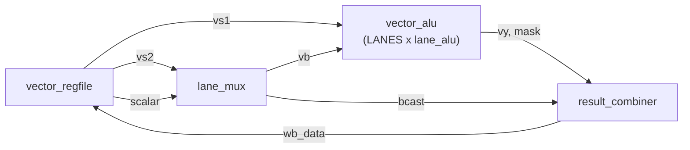
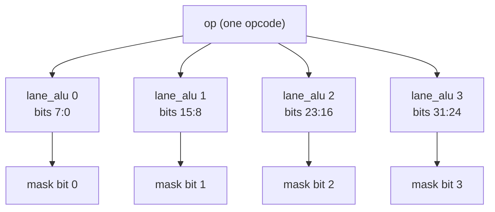
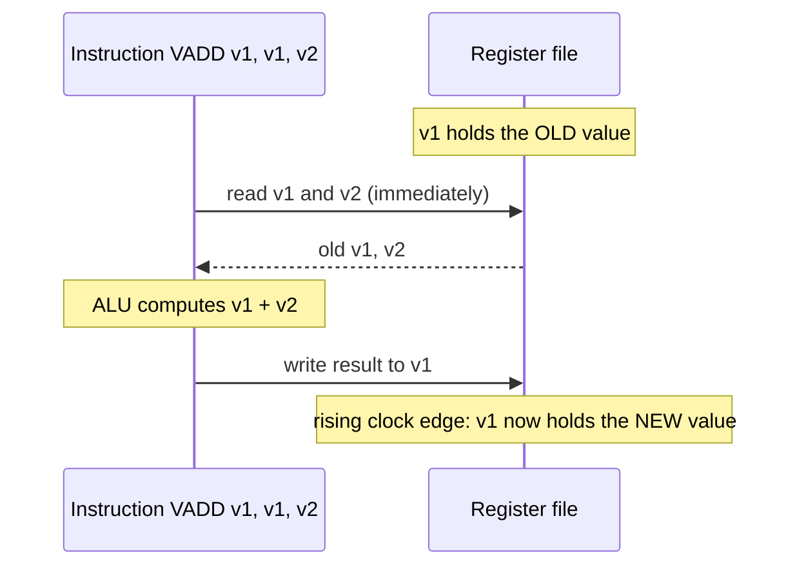

# Datapath Modules

The blocks that hold and process data. Each one is in `rtl/` and has its own testbench `tb/tb_<module>.v`.

The vector datapath modules take two parameters: `LANES` (default 4) and `WIDTH` (default 8). The single-lane `lane_alu` takes only `WIDTH`. In the tables, **VW** means `LANES × WIDTH`, the width of one vector (32 bits by default).

Supported project lane widths are 2, 4, 8 and 16 bits. Wider RTL instances require a wider reference model and separate validation before they can be advertised as supported.



---

## 1. `lane_alu`: one lane

**File:** [`rtl/lane_alu.v`](../rtl/lane_alu.v)

A combinational `WIDTH`-bit ALU. It implements the 10 ALU operations with one `case` statement on the opcode.

| Port | Direction | Width | Meaning |
|---|---|---|---|
| `a` | in | `WIDTH` | operand A (from `vs1`) |
| `b` | in | `WIDTH` | operand B (from `vs2` or the scalar) |
| `op` | in | 4 | opcode |
| `y` | out | `WIDTH` | result |
| `flag` | out | 1 | 1 when a compare is true |

How it behaves:

* Arithmetic wraps: the result keeps only the low `WIDTH` bits.
* `VCMPLT` compares as **signed** numbers (`$signed(a) < $signed(b)`).
* Compares set `flag` and make `y` all ones (`0xFF`) when true, all zeros when false.
* Shifts use only the low `log2(WIDTH)` bits of `b` (3 bits for 8-bit lanes).
* For non-ALU opcodes (`NOP`, `SLI`, `VLD`, `VST`, `VBCAST`, `HALT`) the outputs are 0.
* Default values are assigned before the `case`, so every path sets every output and no latches are created.

---

## 2. `vector_alu`: the SIMD core

**File:** [`rtl/vector_alu.v`](../rtl/vector_alu.v)

Places `LANES` copies of `lane_alu` side by side using a `generate` loop. Lane *i* is connected to bits `[i*WIDTH +: WIDTH]` of each input and of the output.



| Port | Direction | Width | Meaning |
|---|---|---|---|
| `va`, `vb` | in | VW | vector operands |
| `op` | in | 4 | opcode, sent to every lane |
| `vy` | out | VW | vector result |
| `mask` | out | `LANES` | bit *i* = compare result of lane *i* |

**The opcode is the only signal shared by the lanes.** No carry, borrow or shifted bit can pass from one lane to another, because each lane is a separate ALU.

---

## 3. `vector_regfile`: registers

**File:** [`rtl/vector_regfile.v`](../rtl/vector_regfile.v)

Holds 8 vector registers (`v0`–`v7`) and one scalar register.

| Port | Direction | Width | Meaning |
|---|---|---|---|
| `clk` | in | 1 | clock |
| `rst` | in | 1 | synchronous reset: clears every register |
| `raddr1` → `rdata1` | in → out | 3 → VW | read port 1 |
| `raddr2` → `rdata2` | in → out | 3 → VW | read port 2 |
| `we`, `waddr`, `wdata` | in | 1, 3, VW | write port |
| `s_we`, `s_wdata` | in | 1, `WIDTH` | scalar write |
| `scalar` | out | `WIDTH` | scalar value |

**Timing:** reads are immediate (combinational); writes happen on the rising clock edge.



Because a register keeps its old value until the clock edge, an instruction can safely read and write the same register. No forwarding logic is needed.

---

## 4. `lane_mux`: operand B select

**File:** [`rtl/lane_mux.v`](../rtl/lane_mux.v)

Chooses the second operand for the ALU.

```
vb    = sel_scalar ? {scalar, scalar, scalar, scalar} : vs2_data
bcast = {scalar, scalar, scalar, scalar}
```

| Port | Direction | Width | Meaning |
|---|---|---|---|
| `vs2_data` | in | VW | register-file read port 2 |
| `scalar` | in | `WIDTH` | scalar register |
| `sel_scalar` | in | 1 | the instruction's `s` bit |
| `vb` | out | VW | operand B for the vector ALU |
| `bcast` | out | VW | the scalar copied into every lane (used by `VBCAST`) |

Copying the scalar into every lane costs nothing: it is just the same wires connected to four places. The only real hardware is one 2-to-1 multiplexer per bit.

---

## 5. `result_combiner`: write-back select

**File:** [`rtl/result_combiner.v`](../rtl/result_combiner.v)

Chooses the value written to the destination register, using `wb_sel` from the control unit.

| `wb_sel` | Value written | Used by |
|---|---|---|
| `0` (`WB_ALU`) | ALU result | `VADD` … `VMUL`, compares |
| `1` (`WB_MEM`) | data loaded from memory | `VLD` |
| `2` (`WB_BCAST`) | scalar copied to every lane | `VBCAST` |
| `3` (reserved) | zero | – |

It also summarises the compare mask:

| Output | Meaning | Example, mask = `0101` |
|---|---|---|
| `mask_out` | the mask itself | `0101` |
| `any_true` | at least one lane true | 1 |
| `all_true` | every lane true | 0 |
| `mask_count` | number of true lanes | 2 |

| Port | Direction | Width | Meaning |
|---|---|---|---|
| `wb_sel` | in | 2 | source select |
| `alu_y`, `alu_mask` | in | VW, `LANES` | from the vector ALU |
| `mem_rdata` | in | VW | from data memory |
| `bcast` | in | VW | from the lane MUX |
| `wb_data` | out | VW | value to write back |
| `mask_out`, `any_true`, `all_true`, `mask_count` | out | `LANES`, 1, 1, `$clog2(LANES+1)` | mask summary |

`$clog2(LANES+1)` rounds log2(`LANES+1`) up to an integer, so `mask_count` can represent every value from 0 to `LANES`: 1 bit for one lane, 3 bits for four lanes and 4 bits for eight lanes.

**Next:** [control_unit.md](control_unit.md)
