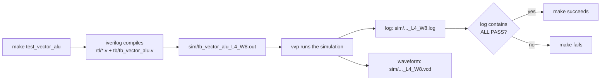

# Getting Started

How to install the tools, run the tests, look at waveforms and run synthesis.

## 1. Install the tools

| Tool | Used for | Install |
|---|---|---|
| Icarus Verilog | compiling and simulating Verilog | macOS: `brew install icarus-verilog` · Ubuntu/WSL: `sudo apt install iverilog` |
| Yosys | synthesis (hardware cost estimate) | macOS: `brew install yosys` · Ubuntu/WSL: `sudo apt install yosys` |
| Python 3.9+ | reproducible configuration, mutation and coverage evidence | macOS: `brew install python` · Ubuntu/WSL: `sudo apt install python3` |
| WaveTrace (VS Code extension) or GTKWave | viewing waveforms | VS Code Extensions panel → "WaveTrace" · Linux: `sudo apt install gtkwave` |
| Tectonic (optional) | building the report PDF | macOS: `brew install tectonic` |
| OSS CAD Suite (optional) | FPGA place and route and Fmax (`make fpga`): Yosys + nextpnr-ecp5 | download the archive for your OS from the [YosysHQ releases](https://github.com/YosysHQ/oss-cad-suite-build/releases), unpack it to `~/tools/oss-cad-suite`, or pass `OSS_CAD=/path/to/oss-cad-suite/bin` to `make fpga` |

Check the install:

```bash
iverilog -V      # Icarus Verilog version 12 or 13
yosys -V
```

## 2. Run the tests

All commands are run from the project root folder.

```bash
make all_tests              # every testbench, 4 lanes x 8 bits
make test_simd_top          # one testbench (the whole processor)
make help                   # list all targets and testbenches
```

Run the same tests on other sizes of the design:

```bash
make all_tests LANES=1      # scalar baseline
make all_tests LANES=8      # 8 lanes
make all_tests WIDTH=16     # 16-bit lanes
```

Every testbench ends with one of these lines:

```
ALL PASS
FAILED with 3 errors
```

`make` stops with an error as soon as a test fails, so `make all_tests` finishing means everything passed.

To reproduce the submitted verification evidence:

```bash
make verify_matrix         # all 12 combinations of LANES=1,4,8 and WIDTH=2,4,8,16
make mutation_tests        # 23 RTL mutations and 6 negative coverage probes
```

These commands use temporary copies, remove their build files after the run, and save complete logs in `results/`. `results/verification_matrix.txt` links each configuration log; `results/mutations.txt` and `results/coverage_guards.txt` record the fault and coverage checks. The runners require only Python's standard library and Icarus Verilog. Each simulation command has a 120-second timeout; `python3 scripts/verify_evidence.py --help` shows the concurrency and timeout options.

## 3. What happens when you run a test



Output files are named after the configuration (`L4_W8` = 4 lanes, 8 bits), so results from different sizes never overwrite each other.

## 4. View a waveform

1. Run a test, e.g. `make test_simd_top`.
2. Open `sim/tb_simd_top_L4_W8.vcd` in VS Code (WaveTrace) or GTKWave.
3. Add signals such as `dut.pc`, `dut.instr` and `dut.u_rf.vregs` to see the program run.

Large exhaustive tests only record the first, easy-to-read part of the run, to keep the files small.

## 5. Run synthesis

```bash
make synth LANES=4 WIDTH=8
```

This synthesises `synthesis/simd_synth_top.v`, which supplies variable instructions to the processor. It prints the cell hierarchy and saves statistics, tool version, parameters, command and source hashes to `results/synth_L4_W8.txt`. The count includes the datapath, data memory, PC and counters; instruction ROM is excluded. See [synthesis_and_performance.md](synthesis_and_performance.md) for what the numbers mean.

## 5b. FPGA resources and maximum frequency

```bash
make synth_scaling          # generic synthesis for 1, 4 and 8 lanes -> results/synth_scaling.csv
make fpga                   # Lattice ECP5-85F, 3 placement seeds per build -> results/fpga/, results/fpga_summary.csv
make fpga FPGA_LANES=4 FPGA_SEEDS=1,2,3,4,5
```

`make fpga` needs the OSS CAD Suite (Homebrew has no `nextpnr-ecp5` package). On macOS, the first run of a downloaded binary may be blocked by Gatekeeper; allow it in System Settings → Privacy & Security, or run `xattr -dr com.apple.quarantine ~/tools/oss-cad-suite` once.

## 6. Build the report

```bash
cd docs/report
tectonic main.tex           # produces main.pdf
```

Or upload `main.tex`, `references.bib` and `fig_waveform.tex` to Overleaf, and set `main.tex` as the main document.

## 7. Troubleshooting

| Problem | Cause and fix |
|---|---|
| A test prints `FAIL` lines | Read the first `FAIL` line: it shows the inputs, the wrong output and the expected output. The full log is in `sim/`. |
| Not sure a rebuild happened after changing `LANES` | It always does, because build files are named per configuration. `make clean` removes all build outputs if you want a fresh start. |
| `tb_defs` rejects a `WIDTH` value | Supported values are 2, 4, 8 and 16. Shift amounts require a power of two; wider lanes are outside the current reference-model support. |
| A new testbench does not compile | The Makefile already passes `-g2012`. Icarus does **not** support associative arrays, `string` methods like `getc()`, `$isunknown`, or unpacked structs. Use fixed-size arrays and `struct packed`. |
| `Not enough words in the file` warning | Normal when a hex program is shorter than the memory. The rest of memory keeps its default value. |
| GTKWave is not available on macOS | Use the WaveTrace extension in VS Code. |

**Next:** [architecture.md](architecture.md)
