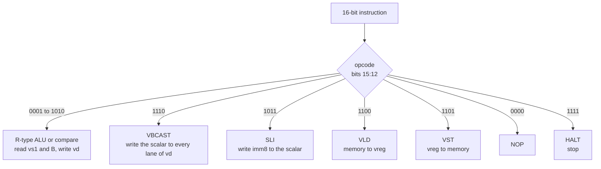

# Instruction Set

Everything a program can see and do. All encodings are defined once in [`rtl/simd_defs.vh`](../rtl/simd_defs.vh); every other file uses those definitions.

## Programmer-visible state

Sizes are for the default 4 lanes × 8 bits.

| State | Size | Notes |
|---|---|---|
| Vector registers `v0`–`v7` | 8 × 32 bits | lane *i* is bits `[8i+7 : 8i]` |
| Scalar register `s` | 8 bits | set by `SLI`; used by `VBCAST` and by any instruction with `s = 1` |
| Mask status | 4 bits | one bit per lane, from the last compare instruction |
| Instruction memory | 256 × 16 bits | addressed by the 8-bit program counter |
| Data memory | 512 × 32 bits | one word holds one whole vector |

## Instruction formats

Every instruction is 16 bits. The top 4 bits are always the opcode.

```
          15    12 11      9 8       6 5       3   2    1  0
R-type   | opcode |   vd    |   vs1   |   vs2   | s  | 00 |     register operations
M-type   | opcode |  vreg   |        addr[8:0]            |     load and store
S-type   | opcode |  0000   |        imm8[7:0]            |     set the scalar
```

| Field | Meaning |
|---|---|
| `vd` | destination register |
| `vs1`, `vs2` | source registers |
| `s` | operand B select: `0` = register `vs2`, `1` = scalar copied into every lane |
| `vreg` | register to load into (`VLD`) or store from (`VST`) |
| `addr` | data-memory address, 0–511 |
| `imm8` | 8-bit constant for `SLI` |

## The 16 instructions

**B** means `vs2` when `s = 0`, or the scalar when `s = 1`. Every operation happens in every lane *i* at once.

### Arithmetic and logic

| Opcode | Instruction | What it does (per lane *i*) |
|---|---|---|
| `0001` | `VADD vd, vs1, B` | `vd[i] = vs1[i] + B[i]` |
| `0010` | `VSUB vd, vs1, B` | `vd[i] = vs1[i] − B[i]` |
| `0011` | `VAND vd, vs1, B` | `vd[i] = vs1[i] AND B[i]` |
| `0100` | `VOR vd, vs1, B` | `vd[i] = vs1[i] OR B[i]` |
| `0101` | `VXOR vd, vs1, B` | `vd[i] = vs1[i] XOR B[i]` |
| `1000` | `VSLL vd, vs1, B` | `vd[i] = vs1[i] << (B[i] mod 8)` |
| `1001` | `VSRL vd, vs1, B` | `vd[i] = vs1[i] >> (B[i] mod 8)`, zeros shifted in |
| `1010` | `VMUL vd, vs1, B` | `vd[i] = low 8 bits of vs1[i] × B[i]` |

### Compare

| Opcode | Instruction | What it does (per lane *i*) |
|---|---|---|
| `0110` | `VCMPEQ vd, vs1, B` | `vd[i] = 0xFF if vs1[i] == B[i], else 0x00`; mask bit *i* = result |
| `0111` | `VCMPLT vd, vs1, B` | `vd[i] = 0xFF if vs1[i] < B[i] (signed), else 0x00`; mask bit *i* = result |

### Scalar, memory and control

| Opcode | Instruction | Format | What it does |
|---|---|---|---|
| `1011` | `SLI imm8` | S | scalar `s = imm8` |
| `1110` | `VBCAST vd` | R | every lane of `vd` = scalar `s` |
| `1100` | `VLD vreg, [addr]` | M | `vreg = memory[addr]` |
| `1101` | `VST vreg, [addr]` | M | `memory[addr] = vreg` |
| `0000` | `NOP` | – | nothing |
| `1111` | `HALT` | – | stop the program |

## Rules to remember

* **Overflow wraps around:** `0xFF + 0x01 = 0x00`. There are no carry or overflow flags.
* **`VCMPLT` is signed:** `0xFF` means −1, so `0xFF < 0x01` is **true**. `VCMPEQ` does not care about sign.
* **Compare results are masks:** true lanes become `0xFF`, false lanes `0x00`, ready to use with `VAND`/`VOR`.
* **Shift amounts use only the low 3 bits of B** (for 8-bit lanes), so shifts are 0–7.
* **Sources are read before the result is written:** `VADD v1, v1, v2` uses the *old* `v1`.
* **`SLI` zero-extends** its 8-bit constant when lanes are wider than 8 bits.
* **Reserved bits** (R-type bits `[1:0]`, S-type bits `[11:8]`) are ignored.

## How an instruction is decoded



## Encoding examples

| Instruction | Bits, by field | Hex |
|---|---|---|
| `VADD v3, v1, v2` | `0001 011 001 010 0 00` | `1650` |
| `VADD v3, v1, s` | `0001 011 001 000 1 00` | `1644` |
| `VCMPLT v2, v0, s` | `0111 010 000 000 1 00` | `7404` |
| `SLI 0x0A` | `1011 0000 00001010` | `B00A` |
| `VLD v1, [5]` | `1100 001 000000101` | `C205` |
| `VST v3, [64]` | `1101 011 001000000` | `D640` |
| `VBCAST v7` | `1110 111 000 000 0 00` | `EE00` |
| `HALT` | `1111 0000 0000 0000` | `F000` |

To encode `VADD v3, v1, v2` by hand: opcode `0001`, then `vd = 3` → `011`, `vs1 = 1` → `001`, `vs2 = 2` → `010`, `s = 0`, two zero bits. Grouped in fours: `0001 0110 0101 0000` = `0x1650`.

**Next:** [datapath_modules.md](datapath_modules.md)
