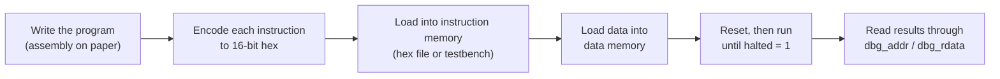

# Programming Guide

How to write a program for the processor, load it, run it and read the results. Instruction details are in [instruction_set.md](instruction_set.md).

Until the assembler is written (Phase II), programs are written as hex words or built with the encoding macros in `rtl/simd_defs.vh`.

## The workflow



## Example 1: add two vectors

```
addr  instruction          hex     meaning
0     VLD  v1, [0]         C200    v1 = memory[0]
1     VLD  v2, [1]         C401    v2 = memory[1]
2     VADD v3, v1, v2      1650    v3 = v1 + v2     (4 additions at once)
3     VST  v3, [2]         D602    memory[2] = v3
4     HALT                 F000
```

| | lane 3 | lane 2 | lane 1 | lane 0 | as hex |
|---|---:|---:|---:|---:|---|
| `memory[0]` | 4 | 3 | 2 | 1 | `04030201` |
| `memory[1]` | 16 | 16 | 16 | 16 | `10101010` |
| `memory[2]` (result) | 20 | 19 | 18 | 17 | `14131211` |

Result: `memory[2] = 0x14131211` after **5 cycles**, with `lane_ops = 4`. (This example was run on the actual design and gives exactly these values.)

## Example 2: add a constant to every element

```
SLI   0x05              B005    scalar = 5
VLD   v1, [0]           C200    v1 = memory[0]
VADD  v2, v1, s         1444    v2 = v1 + 5 in every lane
VST   v2, [1]           D401    memory[1] = v2
HALT                    F000
```

The `s` bit (bit 2) makes `VADD` use the scalar as operand B, copied into every lane. With `memory[0] = 0x28140A01` (lanes 40, 20, 10, 1), the result is `memory[1] = 0x2D190F06` (45, 25, 15, 6) after 5 cycles.

## Example 3: keep only the elements below a threshold

```
SLI    0x05             B005    scalar = 5 (the threshold)
VLD    v1, [0]          C200    v1 = memory[0]
VCMPLT v2, v1, s        7444    v2 = 0xFF where v1 < 5, else 0x00
VAND   v3, v1, v2       3650    v3 = v1 where v1 < 5, else 0
VST    v3, [1]          D601    memory[1] = v3
HALT                    F000
```

With `memory[0] = 0x07010903` (lane 3 to lane 0: 7, 1, 9, 3), the result is `memory[1] = 0x00010003` (0, 1, 0, 3) after 6 cycles, and `mask_status = 0101` (lanes 2 and 0 were below 5).

## Loading a program

### Option 1: hex files

Write one hex word per line:

```
programs/add.hex          programs/add_data.hex
C200                      04030201
C401                      10101010
1650
D602
F000
```

Pass the file names as parameters:

```verilog
simd_top #(.LANES(4), .WIDTH(8),
           .IMEM_INIT("programs/add.hex"),
           .DMEM_INIT("programs/add_data.hex")) dut ( /* ports */ );
```

Connect `instr_in` to `16'h0000` in this default instruction-memory mode. The optional external instruction mode is used by the synthesis wrapper; see [top_level_processor.md](top_level_processor.md).

Icarus prints `Not enough words in the file` when a file is shorter than the memory. That is normal: the remaining instruction slots stay `HALT` and the remaining data words stay 0.

### Option 2: from a testbench

This is how `tb/tb_simd_top.v` works. The encoding macros build the instruction words:

```verilog
dut.imem[0] = `ENC_M(`OP_VLD, 1, 0);           // VLD  v1, [0]
dut.imem[1] = `ENC_M(`OP_VLD, 2, 1);           // VLD  v2, [1]
dut.imem[2] = `ENC_R(`OP_VADD, 3, 1, 2, 0);    // VADD v3, v1, v2
dut.imem[3] = `ENC_M(`OP_VST, 3, 2);           // VST  v3, [2]
dut.imem[4] = {`OP_HALT, 12'h000};             // HALT
dut.dmem[0] = 32'h04030201;
dut.dmem[1] = 32'h10101010;
```

| Macro | Builds | Arguments |
|---|---|---|
| `` `ENC_R(op, vd, vs1, vs2, s) `` | R-type | opcode, destination, sources, scalar bit |
| `` `ENC_M(op, vreg, addr) `` | M-type | opcode, register, memory address |
| `` `ENC_S(op, imm) `` | S-type | opcode, 8-bit constant |

## Running and reading results

```verilog
rst = 1;  @(negedge clk);  rst = 0;     // reset
wait (halted);                           // run until HALT
dbg_addr = 2;  #1;                       // select memory[2]
$display("memory[2] = %h, cycles = %0d", dbg_rdata, cycle_count);
```

## Tips

* End every program with `HALT`. A short program can stop at an untouched HALT-filled slot, but a full 256-instruction image without `HALT` wraps the PC and repeats. External instruction sources must supply `HALT` explicitly.
* Use `SLI` + the `s` bit for constants instead of loading a vector of copies.
* Remember that `VCMPLT` is signed: values `0x80`–`0xFF` count as negative.
* Data-memory addresses go up to 511; there are 8 vector registers, `v0`–`v7`.

**Next:** [verification.md](verification.md)
