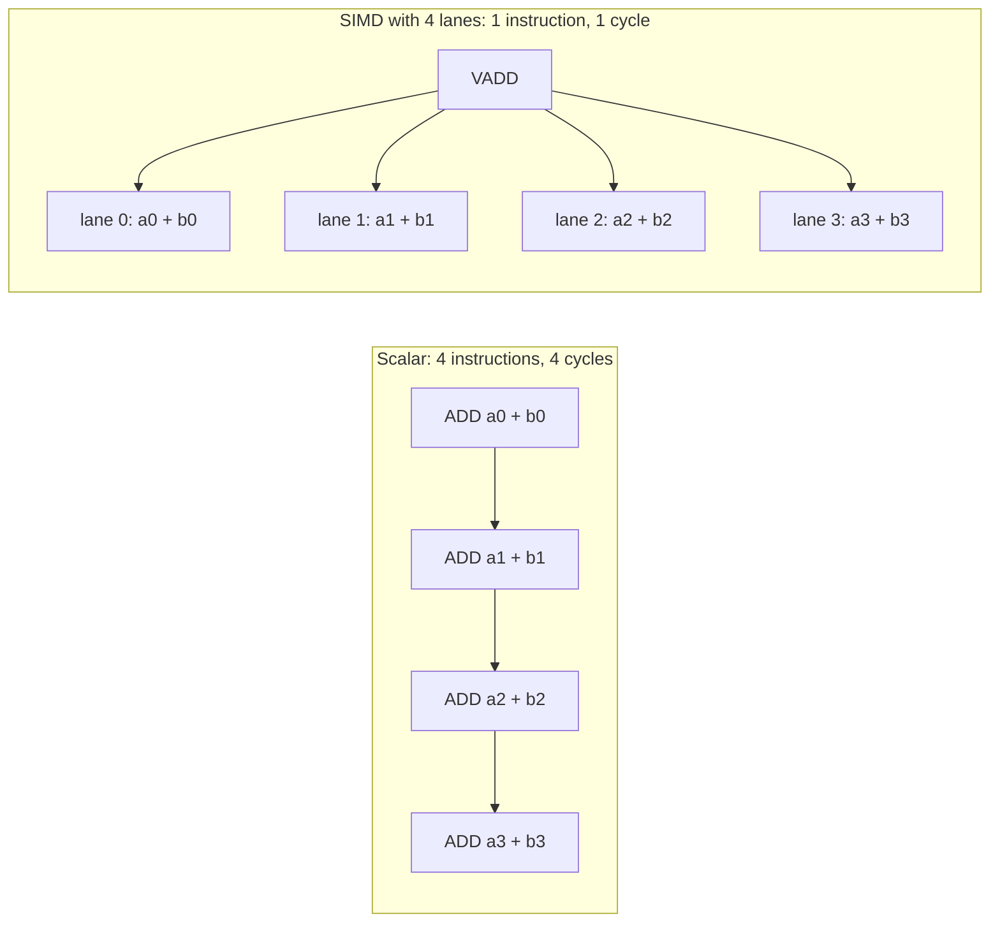
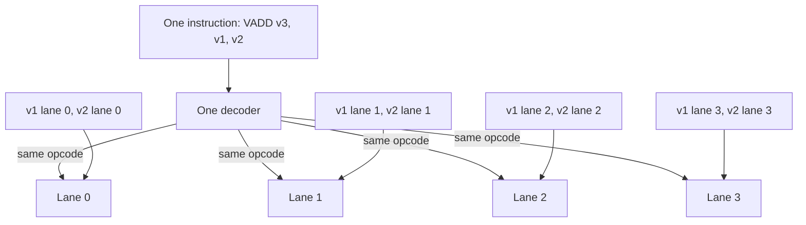
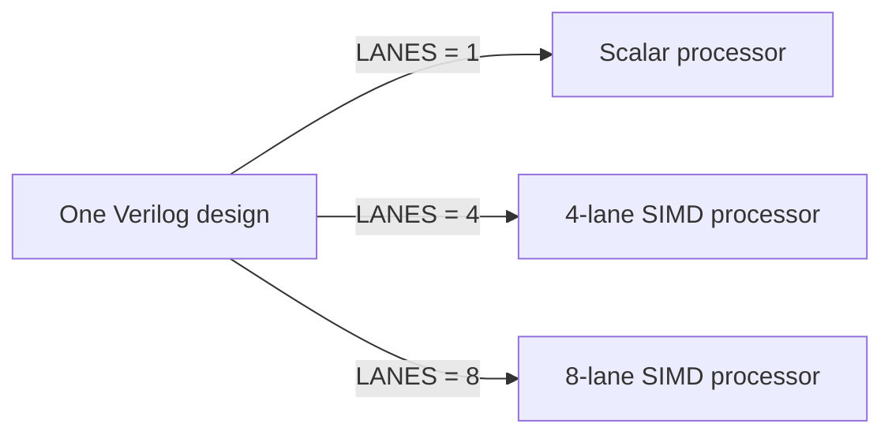

# SIMD Concepts

This page explains the ideas the whole project is built on. No Verilog knowledge is needed.

## What SIMD means

**SIMD** stands for **Single Instruction, Multiple Data**. One instruction is applied to several data elements at the same time.

A normal (scalar) processor adds one pair of numbers per instruction. A SIMD processor adds several pairs per instruction.



This is useful whenever the same operation is applied to many independent values: image pixels, audio samples, or the elements of an array.

## Lanes and vectors

A **lane** is one small ALU that handles one data element. This design has **4 lanes** by default, each **8 bits** wide.

A **vector** is all the lanes' data packed together. With 4 lanes of 8 bits, a vector is 32 bits. Lane 0 is in the lowest bits:

```
bit:    31 ...... 24 23 ...... 16 15 ....... 8 7 ........ 0
       |   lane 3   |   lane 2   |   lane 1   |   lane 0   |

32'h04030201   means   lane 3 = 4,  lane 2 = 3,  lane 1 = 2,  lane 0 = 1
```

The number of lanes (`LANES`) and the lane width (`WIDTH`) are parameters, so the same design can be built with 1, 4 or 8 lanes.

## Lanes must be independent

Each lane is a separate 8-bit ALU. A carry out of one lane must **not** go into the next lane. This is what separates a SIMD unit from one big ALU.

| Operation | One 32-bit adder | Four 8-bit lanes (SIMD) |
|---|---|---|
| `0xFFFFFFFF + 0x01010101` | `0x01010100` (carries ripple across) | `0x00000000` (each lane wraps on its own) |

Each lane computes `0xFF + 0x01 = 0x00` and throws its carry away. The tests check this explicitly (see [verification.md](verification.md)).

## One instruction, many lanes

All lanes receive the **same opcode** from a single decoder. Only the data differs between lanes.



Fetching and decoding happen once, however many lanes there are. That is where the saving comes from.

## Vector-scalar operations (broadcast)

Often you want to combine every element with the **same** value, e.g. "add 5 to every element". The design has a scalar register whose value can be **broadcast**: copied into every lane as the second operand. One instruction then does the whole job.

```
v1          = | 10 | 20 | 30 | 40 |
scalar s    = 5   ->  broadcast  | 5 | 5 | 5 | 5 |
VADD v2, v1, s  ->  v2 = | 15 | 25 | 35 | 45 |
```

## Compare results are masks

A compare instruction sets each lane to `0xFF` (true) or `0x00` (false). The result can be used directly as a bit mask, for example to keep only the elements that passed a test:

```
                       lane 3  lane 2  lane 1  lane 0
v1                  =  |  7   |  1   |  9   |  3   |      threshold s = 5
VCMPLT v2, v1, s    -> |  00  |  FF  |  00  |  FF  |      7<5?  1<5?  9<5?  3<5?
VAND   v3, v1, v2   -> |  0   |  1   |  0   |  3   |      keeps only the elements below 5
```

The lane results also form a 4-bit **mask**, here `0101` (lane 3 on the left, lane 0 on the right), which is kept in a status register. This exact example is run in [programming_guide.md](programming_guide.md).

## The scalar baseline is the same design

To measure how much SIMD helps, we need a scalar version to compare against. Instead of writing a separate processor, we build **the same design with `LANES = 1`**. Both versions then have the same instruction set, the same decoder and the same clock; only the number of lanes differs.



## Measuring speedup

Every instruction takes exactly **one clock cycle**. So the time a program takes, in cycles, is simply the number of instructions it executes.

```
speedup  =  cycles with 1 lane  /  cycles with N lanes        (at most N)
```

Example: adding two arrays of 32 elements.

| Version | Instructions needed | Cycles |
|---|---|---:|
| 1 lane | 32 × (load, load, add, store) + HALT | 129 |
| 4 lanes | 8 × (load, load, add, store) + HALT | 33 |
| Speedup | | ≈ 3.9× |

The speedup is slightly below 4 because the final `HALT` costs one cycle in both versions. Any work that cannot be split across lanes limits the speedup in the same way (Amdahl's law).

**Next:** [getting_started.md](getting_started.md)
