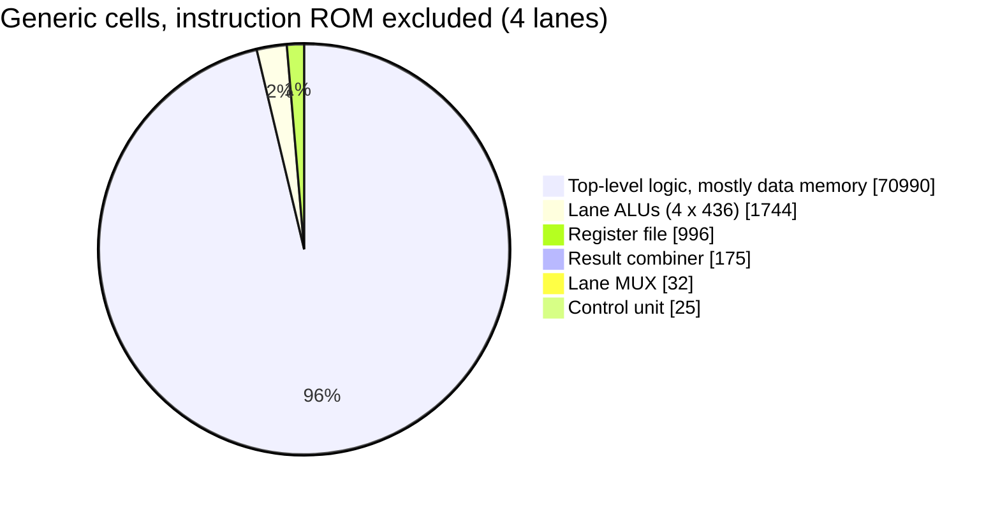
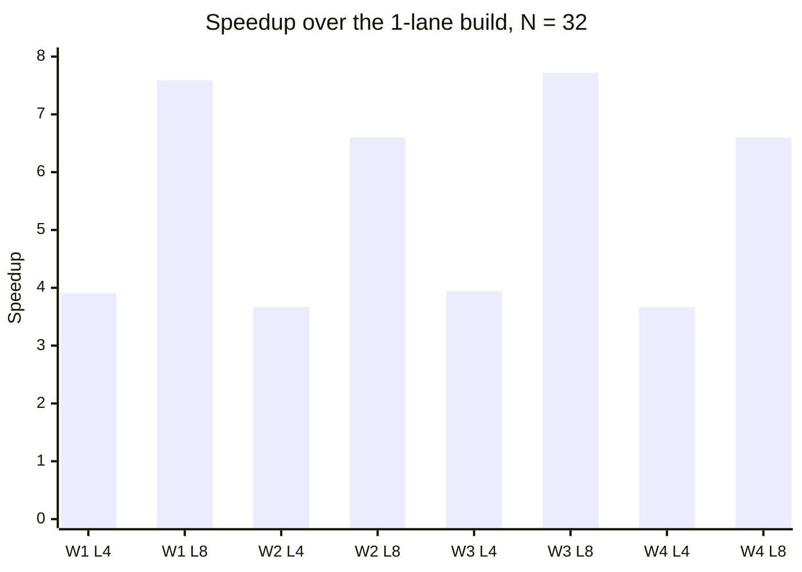

# Synthesis and Performance

What the design costs in hardware, and how much faster the SIMD builds are than the scalar build.

## Synthesis

Synthesis turns the Verilog into logic gates and flip-flops. `make synth` uses Yosys **generic** synthesis, which is not tied to any particular FPGA. The measured configuration is `synthesis/simd_synth_top.v`, a wrapper around the existing `simd_top` processor.

The wrapper enables `EXTERNAL_INSTR=1` and exposes `instr_in` as a variable input. This keeps instruction opcodes and register/memory addresses available to synthesis. Without a program file, the normal instruction memory contains only `HALT`, which can make the datapath constant. The debug and status outputs make the results observable.

The estimate includes the datapath, the 512-word data memory, the PC and counters. **Instruction ROM is excluded.** The wrapper adds no logic of its own after synthesis. Normal tests and example programs use `EXTERNAL_INSTR=0` and continue fetching from instruction memory.

```bash
make synth LANES=4 WIDTH=8        # report: results/synth_L4_W8.txt
```

The report records the Yosys version, UTC generation time, parameters, exact command and SHA-256 hashes of the RTL and wrapper sources. Reproduce it with the recorded command and the same tool version and sources; cell mapping can change between Yosys versions.

### Results, 4 lanes × 8 bits (Yosys 0.70+post)

| Block | Generic cells | Notes |
|---|---:|---|
| `lane_alu` (one lane) | 436 | ×4 lanes = 1,744 |
| `vector_regfile` | 996 | 8 × 32 bits of registers + the scalar |
| `result_combiner` | 175 | write-back select + mask summary |
| `lane_mux` | 32 | one 2-to-1 multiplexer per bit |
| `vector_control` | 25 | the decoder is tiny |
| **SIMD core** | **2,972** | sum of the five block rows above, including four lane ALUs |
| Top-level logic in `simd_top` itself | 70,990 | data memory, PC, counters, write gating (mostly the data memory) |
| Synthesis wrapper itself | 0 | connects the processor ports |
| **Whole synthesis configuration** | **73,962** | instruction ROM excluded |



**Why the total is so much bigger than the core.** Generic synthesis builds the 512 × 32-bit data memory out of 16,384 flip-flops plus read multiplexers. FPGA memory mapping depends on the device and synthesis tool. The current memory has two asynchronous read ports (processor and debug), so direct mapping to synchronous block RAM is not guaranteed. On the ECP5 FPGA (below), Yosys maps it to distributed (LUT) RAM and keeps one copy per read port, so no flip-flops are spent on it. Targeting block RAM would require clocked reads and changes to instruction timing.

("Top-level logic" is everything synthesised directly inside `simd_top` rather than in a submodule: the data memory, the PC, the counters and the write gating. The report gives it as one number; the data memory alone accounts for 16,384 of its flip-flops.)

### How cost grows with lanes

Each lane needs its own ALU, and every register and memory word gets wider. The datapath therefore grows roughly in proportion to `LANES`, while the control unit stays the same size:

| Part | Grows with `LANES`? |
|---|---|
| Lane ALUs | yes, one per lane |
| Register file, data memory | yes, every word is `LANES × WIDTH` bits |
| Lane MUX, result combiner | yes, one multiplexer per bit |
| Control unit, PC, counters | no, shared by all lanes |

Measured with `make synth_scaling` (generic cells, [results/synth_scaling.csv](../results/synth_scaling.csv)):

| Block | 1 lane | 4 lanes | 8 lanes |
|---|---:|---:|---:|
| Lane ALUs (436 cells each) | 436 | 1,744 | 3,488 |
| Vector register file | 276 | 996 | 1,956 |
| Result combiner | 43 | 175 | 357 |
| Lane MUX | 8 | 32 | 64 |
| Control unit | 25 | 25 | 25 |
| **SIMD core** | **788** | **2,972** | **5,890** |
| Top-level logic (mostly data memory) | 18,429 | 70,990 | 141,339 |
| **Whole configuration** | **19,217** | **73,962** | **147,229** |

The core grows 3.8× from 1 to 4 lanes and 7.5× from 1 to 8 lanes, almost exactly in proportion to `LANES`; the decoder stays at 25 cells.

## FPGA implementation (Lattice ECP5)

`make fpga` runs the open-source flow from the YosysHQ OSS CAD Suite: Yosys `synth_ecp5` (0.71) maps the design to ECP5 primitives and nextpnr-ecp5 (0.11.1) places and routes it on an **LFE5U-85F, CABGA381, speed grade 6**, with three placement seeds per build. The top is [`synthesis/fpga_top.v`](../synthesis/fpga_top.v): the processor with a free-running LFSR as its instruction and debug-address source (instruction ROM excluded, as in `make synth`) and every output XOR-folded into one registered pin, so nothing is optimised away and only three pins are used. Inputs and the output are registered, so Fmax is set by the processor's own register-to-register paths. Full evidence: [results/fpga/](../results/fpga/), [results/fpga_summary.csv](../results/fpga_summary.csv).

| | 1 lane | 4 lanes | 8 lanes |
|---|---:|---:|---:|
| Logic cells (TRELLIS_COMB) | 2,200 (2.6%) | 7,606 (9.1%) | 13,261 (15.9%) |
| Flip-flops | 212 | 405 | 664 |
| Distributed-RAM cells (DPR16X4, data memory) | 128 | 512 | 1,024 |
| DSP multipliers (MULT18X18D) | 1 | 4 | 8 |
| Block RAM | 0 | 0 | 0 |
| SIMD core LUT4 (lane ALUs, register file, combiner, MUX, decoder) | 394 | 1,475 | 2,936 |
| Data memory, PC and counters LUT4 | 711 | 2,680 | 4,095 |
| **Fmax, median of 3 seeds** | **60.07 MHz** | **55.50 MHz** | **52.12 MHz** |
| Fmax range over seeds | 59.83–61.54 | 55.43–55.60 | 51.68–52.86 |
| Critical path | 15.7 ns (8.2 ns routing) | 17.5 ns (10.6 ns routing) | 18.4 ns (11.2 ns routing) |

* **Resources scale with lanes.** The core needs one DSP multiplier per lane (`VMUL`) and its LUTs grow 3.7× and 7.5×. The data memory is the largest single block: two read ports (processor and debug) each get their own copy, so 512 × 32 bits needs 512 RAM cells at 4 lanes.
* **Generic flip-flops are not FPGA flip-flops.** Generic synthesis counted 16,755 flip-flops at 4 lanes because it builds the memory from registers; on the FPGA only 405 remain (registers, PC, counters, mask, wrapper).
* **The critical path is the load.** In every build it starts at the instruction's address bits, goes through the 512-entry data-memory read multiplexer and ends at a vector-register flip-flop (`VLD` write-back). Logic delay stays about 7–7.5 ns; the growth comes from routing (8.2 → 11.2 ns), because wider vectors spread the memory and register file over more of the chip.

## Performance

### How it is measured

Every instruction takes one clock cycle, and the processor counts cycles itself (`cycle_count`). Speedup is therefore measured by running the same task on the scalar build (`LANES=1`) and the SIMD build, and dividing the cycle counts:

```
speedup     = cycle_count(LANES=1) / cycle_count(LANES=N)
throughput  = lane_ops / cycle_count           (element operations per cycle)
```

### Workloads

[`scripts/bench.py`](../scripts/bench.py) generates each workload in assembly for a lane count `L` and element count `N`, assembles it, runs it on the RTL and checks it three ways: the outputs against plain Python, the full final state against the ISA model, and the cycle count against the formula below. The same data is used for every `L`. The instruction set has no branch instructions, so every loop is fully unrolled; the generated `N = 32` programs are kept in [`programs/bench/`](../programs/bench/).

| Workload | Task | Per vector of `L` elements | Cycles |
|---|---|---|---|
| W1 | `C = A + B` | `VLD, VLD, VADD, VST` | 4N/L + 1 |
| W2 | count elements below a threshold (signed `<`) | `VLD, VCMPLT s, VSUB` | 3N/L + 3 |
| W3 | `C = (A AND M) OR B` | `VLD ×3, VAND, VOR, VST` | 6N/L + 1 |
| W4 | `Y = a·X + b` (8-bit wrap-around) | `VLD, VMUL s, VADD, VST` | 4N/L + 4 |

W2 uses a trick: a true compare writes −1 (all ones) to its lane, so subtracting the compare result adds 1 to that lane's count. It ends with one partial count per lane. Adding the `L` partial counts needs a cross-lane (horizontal) add, which this ISA does not have; the "with reduction" column charges `L − 1` extra cycles for it.

```bash
make bench                     # -> results/bench.csv and results/bench.txt
```

### Measured results, N = 32, WIDTH = 8

All rows match the predicted cycle count exactly and pass all three checks ([full table for N = 8, 16, 32](../results/bench.txt)).

| Workload | Cycles L=1 | L=4 | L=8 | Speedup L=4 | Speedup L=8 | Elements/cycle L=1 → L=8 |
|---|---:|---:|---:|---:|---:|---|
| W1 add | 129 | 33 | 17 | 3.91× | 7.59× | 0.25 → 1.88 |
| W2 count | 99 | 27 | 15 | 3.67× (3.30× with reduction) | 6.60× (4.50×) | 0.32 → 2.13 |
| W3 mask | 193 | 49 | 25 | 3.94× | 7.72× | 0.17 → 1.28 |
| W4 a·X+b | 132 | 36 | 20 | 3.67× | 6.60× | 0.24 → 1.60 |



**Why the speedup is below `L`.** The per-vector work shrinks by exactly `L`, but the setup instructions (`SLI`, `VBCAST`) and the final `HALT` do not (Amdahl's law). W3 has the most work per vector and the least fixed overhead, so it comes closest to `L`; W2 and W4 carry three or four fixed instructions. For small `N` the effect is larger: at `N = 8` the 8-lane speedup is only 4.5× for W2 and W4. W2 loses more once the cross-lane sum is counted (4.50× instead of 6.60× at `L = 8`), which shows why real SIMD ISAs include horizontal-add or reduction instructions.

### Clock frequency

Wider designs have longer wires, so the clock gets slower. The real benefit is the time per task, `effective speedup = cycle speedup × Fmax(L) / Fmax(1)`, using the median Fmax above:

| Workload (N = 32) | 4 lanes: cycles × clock = effective | 8 lanes: cycles × clock = effective |
|---|---|---|
| W1 add | 3.91 × 0.924 = **3.61×** | 7.59 × 0.868 = **6.58×** |
| W2 count (with reduction) | 3.30 × 0.924 = **3.05×** | 4.50 × 0.868 = **3.90×** |
| W3 mask | 3.94 × 0.924 = **3.64×** | 7.72 × 0.868 = **6.70×** |
| W4 a·X+b | 3.67 × 0.924 = **3.39×** | 6.60 × 0.868 = **5.73×** |

For W1, the 8-lane build finishes in 17 cycles at 52.1 MHz (326 ns) against 129 cycles at 60.1 MHz (2,147 ns) for the scalar build. The clock loses 13%, so 8 lanes still give about 6.6× in real time while using 6.0× the logic cells.
