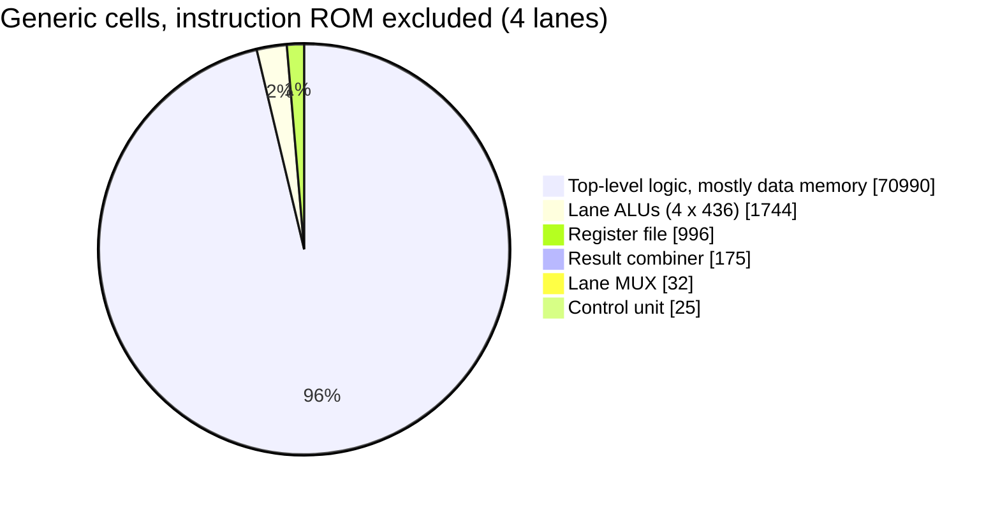
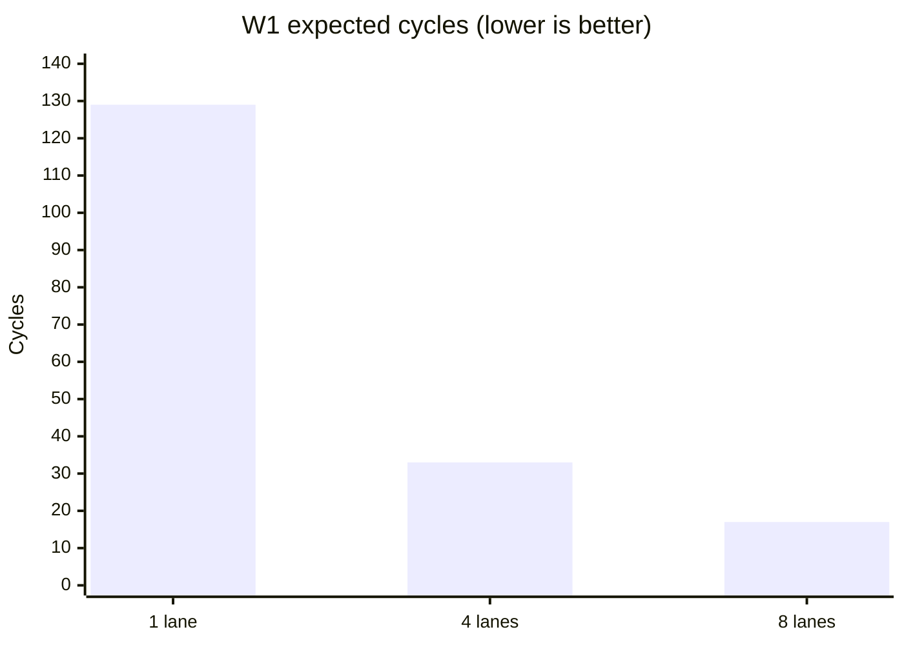

# Synthesis and Performance

What the design costs in hardware, and how the speed of the scalar and SIMD versions will be compared.

## Synthesis

Synthesis turns the Verilog into logic gates and flip-flops. `make synth` uses Yosys **generic** synthesis, which is not tied to any particular FPGA. The measured configuration is `synthesis/simd_synth_top.v`, a wrapper around the existing `simd_top` processor.

The wrapper enables `EXTERNAL_INSTR=1` and exposes `instr_in` as a variable input. This keeps instruction opcodes and register/memory addresses available to synthesis. Without a program file, the normal instruction memory contains only `HALT`, which can make the datapath constant. The debug and status outputs make the results observable.

The estimate includes the datapath, the 512-word data memory, the PC and counters. **Instruction ROM is excluded.** The wrapper adds no logic of its own after synthesis. Normal tests and example programs use `EXTERNAL_INSTR=0` and continue fetching from instruction memory.

```bash
make synth LANES=4 WIDTH=8        # report: results/synth_L4_W8.txt
```

The report records the Yosys version, UTC generation time, parameters, exact command and SHA-256 hashes of the RTL and wrapper sources. Reproduce it with the recorded command and the same tool version and sources; cell mapping can change between Yosys versions.

### Results, 4 lanes × 8 bits (Yosys 0.70+post)

| Block | Generic cells | Notes |
|---|---:|---|
| `lane_alu` (one lane) | 436 | ×4 lanes = 1,744 |
| `vector_regfile` | 996 | 8 × 32 bits of registers + the scalar |
| `result_combiner` | 175 | write-back select + mask summary |
| `lane_mux` | 32 | one 2-to-1 multiplexer per bit |
| `vector_control` | 25 | the decoder is tiny |
| **SIMD core** | **2,972** | sum of the five block rows above, including four lane ALUs |
| Top-level logic in `simd_top` itself | 70,990 | data memory, PC, counters, write gating (mostly the data memory) |
| Synthesis wrapper itself | 0 | connects the processor ports |
| **Whole synthesis configuration** | **73,962** | instruction ROM excluded |



**Why the total is so much bigger than the core.** Generic synthesis builds the 512 × 32-bit data memory out of 16,384 flip-flops plus read multiplexers. FPGA memory mapping depends on the device and synthesis tool. The current memory has two asynchronous read ports (processor and debug), so direct mapping to synchronous block RAM is not guaranteed. A tool may use distributed RAM, replicate memory, or keep registers and multiplexers. Phase II will measure the actual mapping and report memory and core resources separately. Targeting block RAM may require clocked reads and changes to instruction timing.

("Top-level logic" is everything synthesised directly inside `simd_top` rather than in a submodule: the data memory, the PC, the counters and the write gating. The report gives it as one number; the data memory alone accounts for 16,384 of its flip-flops.)

### How cost grows with lanes

Each lane needs its own ALU, and every register and memory word gets wider. The datapath therefore grows roughly in proportion to `LANES`, while the control unit stays the same size:

| Part | Grows with `LANES`? |
|---|---|
| Lane ALUs | yes, one per lane |
| Register file, data memory | yes, every word is `LANES × WIDTH` bits |
| Lane MUX, result combiner | yes, one multiplexer per bit |
| Control unit, PC, counters | no, shared by all lanes |

The 1-, 4- and 8-lane numbers will be measured in Phase II with `make synth LANES=1`, `LANES=4` and `LANES=8`.

## Performance

### How it is measured

Every instruction takes one clock cycle, and the processor counts cycles itself (`cycle_count`). Speedup is therefore measured by running the same task on the scalar build (`LANES=1`) and the SIMD build, and dividing the cycle counts:

```
speedup     = cycle_count(LANES=1) / cycle_count(LANES=N)
throughput  = lane_ops / cycle_count           (element operations per cycle)
```

### Planned workloads (Phase II)

| Workload | Task | Instructions it relies on |
|---|---|---|
| W1 | add two 32-element arrays: `C = A + B` | `VLD`, `VADD`, `VST` |
| W2 | count elements above a threshold | `SLI`, `VCMPLT` with the scalar, `VAND`, `VADD` |
| W3 | bitwise masking: `C = (A AND M) OR B` | `VLD`, `VAND`, `VOR`, `VST` |

### Expected result for W1

| Build | Loop iterations | Instructions | Cycles | Expected speedup |
|---|---:|---|---:|---:|
| 1 lane | 32 | 32 × 4 + HALT | 129 | 1.0× |
| 4 lanes | 8 | 8 × 4 + HALT | 33 | 3.9× |
| 8 lanes | 4 | 4 × 4 + HALT | 17 | 7.6× |



The speedup is a little below the lane count because the final `HALT` costs one cycle in every build. In general, any part of a program that cannot be spread across lanes limits the speedup (Amdahl's law). These are expected values; Phase II will measure them on the design.

### Clock frequency

A faster clock also matters. Wider designs have longer wires and bigger multiplexers, which can lower the maximum frequency. The real benefit is `speedup × (Fmax with N lanes / Fmax with 1 lane)`. Fmax will be measured with an FPGA tool (Vivado or Quartus) in Phase II.
