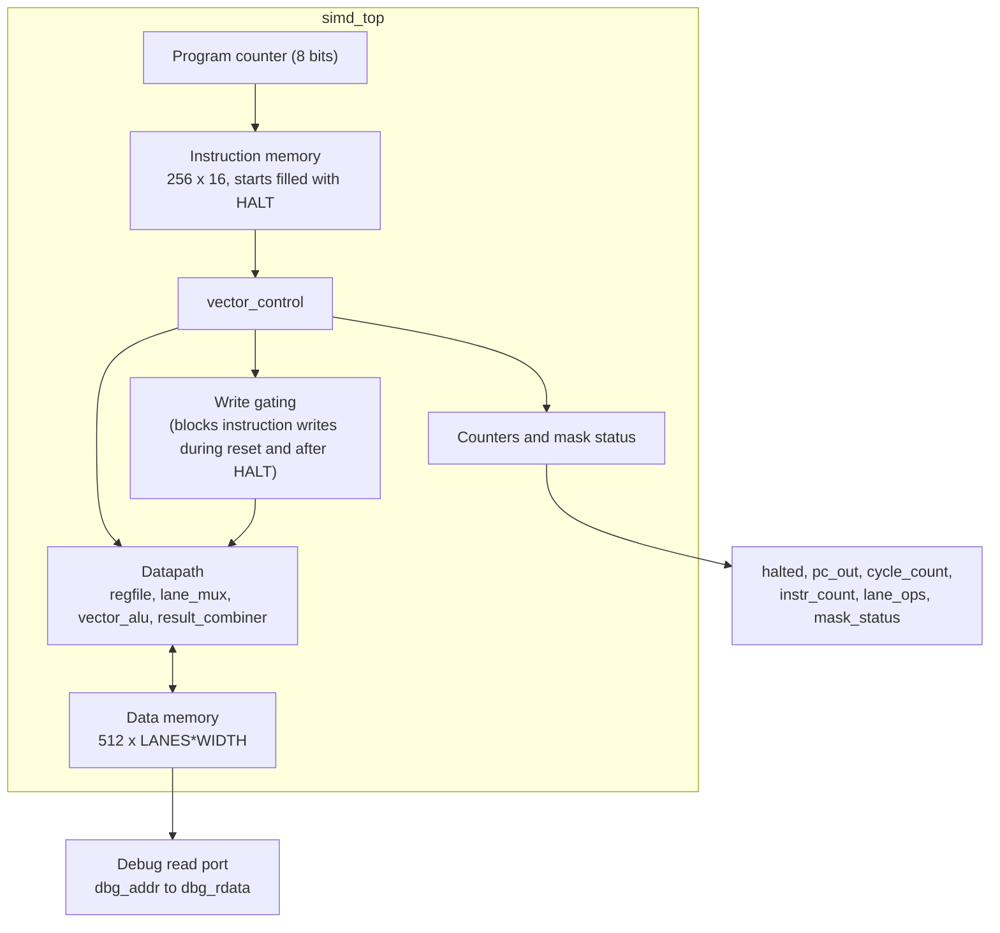
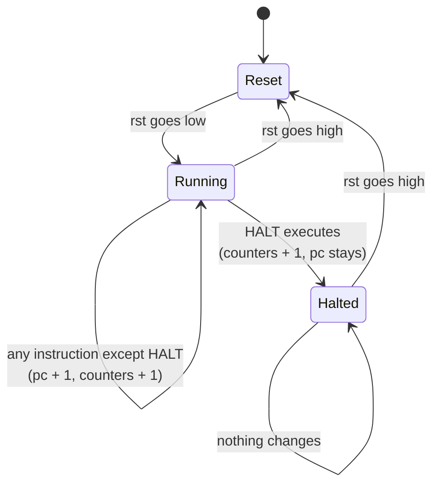

# Top-Level Processor: `simd_top`

**File:** [`rtl/simd_top.v`](../rtl/simd_top.v)

`simd_top` is the complete processor. It connects the control unit and all datapath modules, and adds the memories, the program counter, HALT handling and performance counters.

## Memories

| Memory | Size | Read | Write | Starts as |
|---|---|---|---|---|
| Instruction memory | 256 × 16 bits | immediate, at address `pc` | loaded by the testbench or a hex file | every slot = `HALT` |
| Data memory | 512 × `LANES*WIDTH` bits | immediate | on the clock edge, by `VST` | all zeros |

Filling the instruction memory with `HALT` stops a short program at the first untouched slot it reaches. This requires an unused slot containing `HALT`; a program that fills all 256 slots without `HALT` wraps the 8-bit PC to zero and repeats. The external-instruction mode depends on its input source supplying `HALT`.

## Program counter and HALT

* The PC starts at 0 and goes up by 1 every cycle.
* When `HALT` executes, `halted` becomes 1. The PC stays **on** the `HALT`, so `pc_out` shows where the program stopped.
* After that, every instruction write is blocked: registers, scalar, memory and mask status. Each decoder write enable is ANDed with `!halted && !rst` in one place.
* Reset clears the PC, the counters, the vector and scalar registers, mask status and `halted`. Instruction writes are blocked while reset is asserted, including a pending `VST`. Both memories retain their contents.

## Performance counters

All counters are 32 bits, start at 0 on reset, and stop at `HALT`.

| Counter | Goes up by | Use |
|---|---|---|
| `cycle_count` | 1 each cycle until HALT (the HALT cycle included) | how long the program took |
| `instr_count` | 1 per instruction | always equals `cycle_count`, since each instruction takes one cycle |
| `lane_ops` | `LANES` per vector ALU instruction | how many element operations were done |

**Throughput** (element operations per cycle) = `lane_ops / cycle_count`. With 4 lanes, one `VADD` adds 4 to `lane_ops` in a single cycle.

## Mask status

A `LANES`-bit register (4 bits by default, one bit per lane) that holds the lane results of the **most recent compare** (`VCMPEQ` or `VCMPLT`). Other instructions do not change it.

## Debug read port

`dbg_addr` (input) selects a data-memory word; `dbg_rdata` (output) shows it immediately. It has two purposes:

1. Testbenches read the results through it.
2. Synthesis can observe stored datapath results through it. The synthesis wrapper also supplies variable instructions, so a constant `HALT` program cannot remove the datapath. The measured scope is explained in [synthesis_and_performance.md](synthesis_and_performance.md).

## Optional external instruction source

`EXTERNAL_INSTR=0` is the default: instructions come from `imem[pc]`, and `instr_in` should be tied to `16'h0000`. Tests and example programs keep this mode.

For generic resource estimation, `synthesis/simd_synth_top.v` sets `EXTERNAL_INSTR=1`. Each cycle the decoder uses the 16-bit `instr_in` input; the instruction memory is bypassed. The PC, HALT handling, counters, register file and data memory still use the same RTL. The wrapper exposes the existing status and debug outputs, and instruction ROM is excluded from its cell count.

## Ports

| Port | Direction | Width | Meaning |
|---|---|---|---|
| `clk` | in | 1 | clock |
| `rst` | in | 1 | synchronous, active-high reset |
| `instr_in` | in | 16 | external instruction when `EXTERNAL_INSTR=1`; tie to zero otherwise |
| `halted` | out | 1 | 1 after `HALT` |
| `pc_out` | out | 8 | current program counter |
| `cycle_count` | out | 32 | cycles executed |
| `instr_count` | out | 32 | instructions executed |
| `lane_ops` | out | 32 | element operations performed |
| `mask_status` | out | `LANES` | result of the last compare |
| `dbg_addr` | in | 9 | data-memory address to read |
| `dbg_rdata` | out | `LANES*WIDTH` | data-memory word at `dbg_addr` |

## Parameters

| Parameter | Default | Meaning |
|---|---|---|
| `LANES` | 4 | number of lanes |
| `WIDTH` | 8 | bits per lane; supported values: 2, 4, 8 and 16 |
| `IMEM_INIT` | `""` | optional hex file loaded into instruction memory at start-up |
| `DMEM_INIT` | `""` | optional hex file loaded into data memory at start-up |
| `EXTERNAL_INSTR` | 0 | 0: fetch from instruction memory; 1: decode `instr_in` |

**Next:** [programming_guide.md](programming_guide.md)
