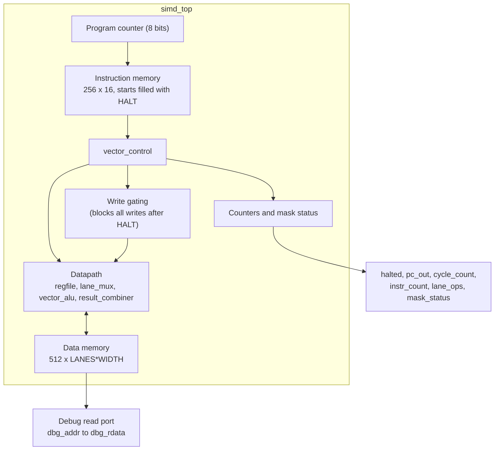
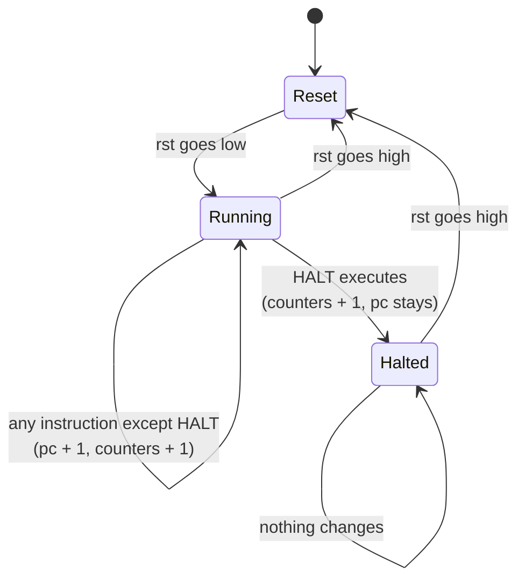

# Top-Level Processor: `simd_top`

**File:** [`rtl/simd_top.v`](../rtl/simd_top.v)

`simd_top` is the complete processor. It connects the control unit and all datapath modules, and adds the memories, the program counter, HALT handling and performance counters.

## Memories

| Memory | Size | Read | Write | Starts as |
|---|---|---|---|---|
| Instruction memory | 256 × 16 bits | immediate, at address `pc` | loaded by the testbench or a hex file | every slot = `HALT` |
| Data memory | 512 × `LANES*WIDTH` bits | immediate | on the clock edge, by `VST` | all zeros |

Filling the instruction memory with `HALT` means that a program which forgets its own `HALT` still stops at the first empty slot, instead of running into empty memory and wrapping around.

## Program counter and HALT

* The PC starts at 0 and goes up by 1 every cycle.
* When `HALT` executes, `halted` becomes 1. The PC stays **on** the `HALT`, so `pc_out` shows where the program stopped.
* After that, every write is blocked: registers, scalar, memory and mask status. This is done in one place, by ANDing each write enable from the decoder with "not halted".
* Reset clears the PC, the counters, the registers and `halted`. It does **not** clear the memories, so a program can be re-run on the same data.

## Performance counters

All counters are 32 bits, start at 0 on reset, and stop at `HALT`.

| Counter | Goes up by | Use |
|---|---|---|
| `cycle_count` | 1 each cycle until HALT (the HALT cycle included) | how long the program took |
| `instr_count` | 1 per instruction | always equals `cycle_count`, since each instruction takes one cycle |
| `lane_ops` | `LANES` per vector ALU instruction | how many element operations were done |

**Throughput** (element operations per cycle) = `lane_ops / cycle_count`. With 4 lanes, one `VADD` adds 4 to `lane_ops` in a single cycle.

## Mask status

A 4-bit register (one bit per lane) that holds the lane results of the **most recent compare** (`VCMPEQ` or `VCMPLT`). Other instructions do not change it.

## Debug read port

`dbg_addr` (input) selects a data-memory word; `dbg_rdata` (output) shows it immediately. It has two purposes:

1. Testbenches read the results through it.
2. Synthesis keeps the datapath. Synthesis tools delete any logic whose result never reaches an output. Without this port, every result would end up in a memory that nothing reads, and the whole datapath would be removed.

## Ports

| Port | Direction | Width | Meaning |
|---|---|---|---|
| `clk` | in | 1 | clock |
| `rst` | in | 1 | synchronous, active-high reset |
| `halted` | out | 1 | 1 after `HALT` |
| `pc_out` | out | 8 | current program counter |
| `cycle_count` | out | 32 | cycles executed |
| `instr_count` | out | 32 | instructions executed |
| `lane_ops` | out | 32 | element operations performed |
| `mask_status` | out | `LANES` | result of the last compare |
| `dbg_addr` | in | 9 | data-memory address to read |
| `dbg_rdata` | out | `LANES*WIDTH` | data-memory word at `dbg_addr` |

## Parameters

| Parameter | Default | Meaning |
|---|---|---|
| `LANES` | 4 | number of lanes |
| `WIDTH` | 8 | bits per lane (power of two) |
| `IMEM_INIT` | `""` | optional hex file loaded into instruction memory at start-up |
| `DMEM_INIT` | `""` | optional hex file loaded into data memory at start-up |

**Next:** [programming_guide.md](programming_guide.md)
