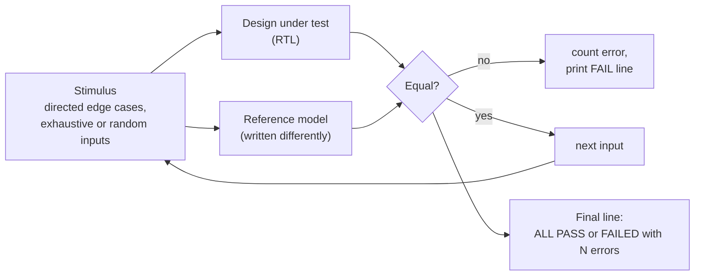

# Verification

How the design was tested, and what the tests found. Every testbench is in `tb/` and runs with `make test_<name>`; `make all_tests` runs them all.

## How a testbench works

Every testbench is **self-checking**: it drives the design, computes the expected answer with an independent **reference model**, compares the two, and counts mismatches. Nobody needs to inspect waveforms to know whether a test passed.



## The methods used

| Method | What it means | Where it is used |
|---|---|---|
| **Independent reference model** | The expected result is computed in a different way from the design (e.g. integer arithmetic and `mod 2^WIDTH` instead of Verilog bit truncation), so a mistake in the design is not copied into the check | all ALU tests |
| **Exhaustive testing** | every possible input is tried | lane ALU (all 65,536 input pairs × 10 operations), control unit (all 65,536 instructions) |
| **Directed edge cases** | hand-picked hard cases: overflow, `0x80` vs `0x7F`, shift by 0 and 7, equal operands | every ALU test |
| **Random testing** | thousands of random inputs, different in every lane | vector ALU, register file, lane MUX, result combiner |
| **Coverage counting** | each testbench counts how often every operation / case was hit, and fails if something was never tested | all |
| **Whole-processor check** | after a program finishes, the *entire* state (all 512 memory words, all registers, scalar, mask, PC, counters) is compared with an instruction-set model that ran the same program | `simd_top` |
| **Planted bugs** | bugs were inserted on purpose into copies of the design, to prove the tests catch them | every module |
| **All sizes** | the whole suite is run with 1, 4 and 8 lanes and with 16-bit lanes | all |

## Results (4 lanes × 8 bits)

| Testbench | Module | What is checked | Checks | Result |
|---|---|---|---:|---|
| `tb_smoke` | – | the tools and the lane bit layout | 4 | PASS |
| `tb_defs` | `simd_defs.vh` | opcodes unique, fields don't overlap, encode/decode round trip | 145 | PASS |
| `tb_lane_alu` | `lane_alu` | **every** input pair for every operation | 656,650 | PASS |
| `tb_vector_alu` | `vector_alu` | lanes independent, lanes not swapped, every mask pattern, random | 51,277 | PASS |
| `tb_vector_regfile` | `vector_regfile` | reset, both read ports, read-during-write, write enable, random vs. model | 15,248 | PASS |
| `tb_lane_mux` | `lane_mux` | pass-through, broadcast of all 256 scalar values | 12,772 | PASS |
| `tb_result_combiner` | `result_combiner` | each source selected, reserved code, every mask pattern | 19,216 | PASS |
| `tb_vector_control` | `vector_control` | **every** possible instruction | 65,536 | PASS |
| `tb_simd_top` | `simd_top` | 9 programs, full final state vs. instruction-set model | 4,752 | PASS |
| **Total** | | | **825,600** | **ALL PASS** |

| Configuration | `make all_tests` |
|---|---|
| `LANES=1` (scalar) | PASS |
| `LANES=4` (default) | PASS |
| `LANES=8` | PASS |
| `WIDTH=16` | PASS |

## Key checks, explained

**Lane independence (vector ALU).** `0xFFFFFFFF + 0x01010101` must give `0x00000000` (each lane wraps), not `0x01010100` (what one 32-bit adder gives). This is the single most important SIMD property.

**Walking lane (vector ALU).** Data is placed in one lane at a time, with a different value in each. If two lanes were wired the wrong way round, the result would appear in the wrong lane.

**Read-during-write (register file).** While a register is being written, reading it must still return the *old* value until the clock edge. This is what makes `VADD v1, v1, v2` correct.

**Every instruction (control unit).** All 65,536 possible 16-bit words are decoded and compared with a reference table, including words with garbage in the reserved bits. The test also checks that no instruction writes to more than one place.

## Whole-processor programs (`tb_simd_top`)

| Program | What it checks | Instructions | Cycles | Lane-ops |
|---|---|---:|---:|---:|
| P1 basic | load, load, add, store, halt | 5 | 5 | 4 |
| P2 all-ops | every ALU operation, with a register and with the scalar as operand B | 44 | 44 | 80 |
| P3 scalar | `SLI`, `VBCAST`, zero-extension of the constant | 10 | 10 | 8 |
| P4 hazards | `VADD v1,v1,v1` six times in a row; store then load the same address | 14 | 14 | 32 |
| P5 mask | the mask changes only on compare instructions | 9 | 9 | 16 |
| P6 no-halt | a program without `HALT` stops at the first empty slot | 3 | 4 | 4 |
| P7 freeze | 50 more cycles after `HALT` change nothing | 44 | 44 | 80 |
| P8 reset | reset in the middle of a run, then a clean run | 44 | 44 | 80 |

Cycles always equal the instructions executed (P6 has one extra: the `HALT` in the empty slot). This confirms **one instruction per cycle**.

## Planted bugs: 23 of 23 caught

To show that the tests really detect mistakes, each bug below was inserted into a copy of the design and the tests were run on it. Every bug was caught.

| Module | Planted bug | Caught by |
|---|---|---|
| `vector_alu` | one 32-bit adder instead of four 8-bit lanes | lane-independence check |
| `vector_alu` | lanes 0 and 1 swapped | walking-lane check |
| `vector_regfile` | write data forwarded straight to the read port | read-during-write check |
| `vector_regfile` | port 2 uses port 1's address | readback check |
| `vector_regfile` | reset does not clear the scalar | reset check |
| `vector_regfile` | write enable ignored | write-enable check |
| `lane_mux` | scalar copied into lane 0 only | pass-through check |
| `lane_mux` | select inverted | pass-through check |
| `lane_mux` | only the top lane gets the scalar | broadcast check |
| `result_combiner` | memory and broadcast sources swapped | select check |
| `result_combiner` | `any_true` looks only at lane 0 | mask-pattern check |
| `result_combiner` | lane count skips the top lane | mask-pattern check |
| `result_combiner` | reserved select passes the ALU result | reserved-code check |
| `vector_control` | `VST` also writes a register | enable check |
| `vector_control` | `s` bit ignored | operand-select check |
| `vector_control` | `VST` reads the wrong register | address check |
| `vector_control` | `VBCAST` selects memory | write-back select check |
| `vector_control` | `halt` has no default value (latch) | enable check |
| `simd_top` | store takes data from the wrong read port | P1 |
| `simd_top` | `SLI` sign-extends instead of zero-extending | P3 with 16-bit lanes* |
| `simd_top` | `lane_ops` counts every instruction | P1 |
| `simd_top` | mask updated on every ALU instruction | P2 |
| `simd_top` | lane MUX bypassed (scalar operand ignored) | P2 |

\* With 8-bit lanes there are no extra bits to extend, so this bug cannot change any result. That is why the suite is also run with 16-bit lanes.

## Reading test output

A passing run:

```
=== Running tb_vector_alu (LANES=4, WIDTH=8) ===
  opcode   checks  fails
  VADD       5005      0  ok
  ...
  mask coverage (lane: seen 0/1): L0:ok L1:ok L2:ok L3:ok
ALL PASS
```

A failure shows the inputs, the wrong output and the expected output:

```
FAIL [A carry] VADD va=ffffffff vb=01010101 : vy=01010100 mask=0000, expected vy=00000000 mask=0000
```

The full log of each run is saved in `sim/tb_<name>_L<lanes>_W<width>.log`.

**Next:** [synthesis_and_performance.md](synthesis_and_performance.md)
