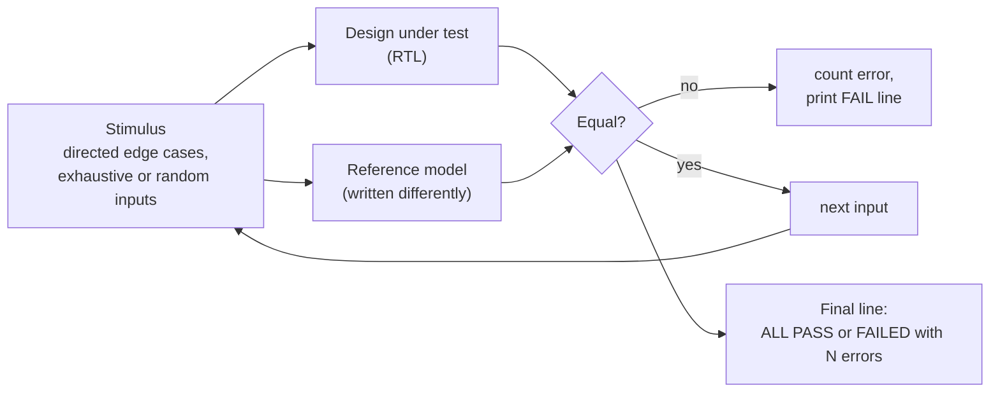
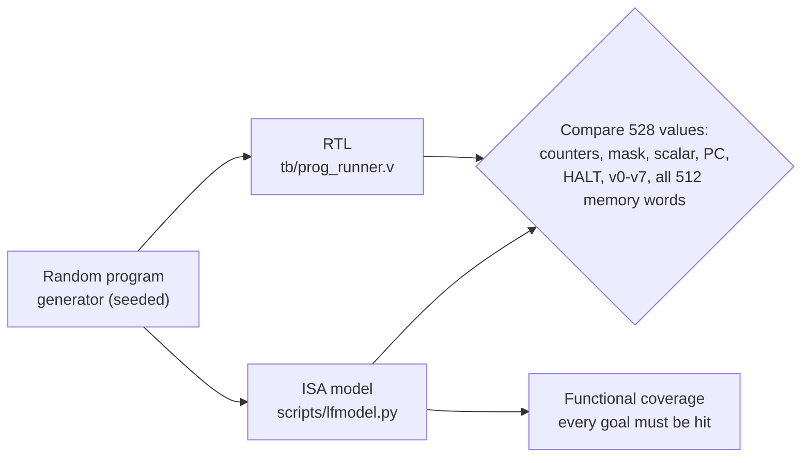

# Verification

How the design was tested, and what the tests found. Every testbench is in `tb/` and runs with `make test_<name>`; `make all_tests` runs them all.

## How a testbench works

Every testbench is **self-checking**: it drives the design, computes the expected answer with an independent **reference model**, compares the two, and counts mismatches. Nobody needs to inspect waveforms to know whether a test passed.



## The methods used

| Method | What it means | Where it is used |
|---|---|---|
| **Independent reference model** | The expected result is computed in a different way from the design (e.g. integer arithmetic and `mod 2^WIDTH` instead of Verilog bit truncation), so a mistake in the design is not copied into the check | all ALU tests |
| **Exhaustive testing** | every possible input is tried | lane ALU (all 65,536 input pairs × 10 operations), control unit (all 65,536 instructions) |
| **Directed edge cases** | hand-picked hard cases: overflow, `0x80` vs `0x7F`, shift by 0 and 7, equal operands | every ALU test |
| **Random testing** | thousands of random inputs, different in every lane | vector ALU, register file, lane MUX, result combiner |
| **Coverage tracking and enforcement** | ALU benches require every opcode to be exercised; the decoder requires 4,096 words per opcode; register-file, lane-MUX and result-combiner benches require every named section. Vector-mask and write-back-select coverage are also enforced | six datapath/control benches |
| **Whole-processor check** | after a program finishes, the *entire* state (all 512 memory words, all registers, scalar, mask, PC, counters) is compared with an instruction-set model that ran the same program | `simd_top` |
| **Planted bugs** | 23 specific faults are inserted separately into temporary copies; each affected bench first passes on unmodified RTL | six RTL modules |
| **Configuration matrix** | all 12 combinations of 1, 4 and 8 lanes with 2-, 4-, 8- and 16-bit lanes | all nine testbenches |

## Results (4 lanes × 8 bits)

| Testbench | Module | What is checked | Checks | Result |
|---|---|---|---:|---|
| `tb_smoke` | – | the tools and the lane bit layout | 4 | PASS |
| `tb_defs` | `simd_defs.vh` | opcodes unique, fields don't overlap, encode/decode round trip | 145 | PASS |
| `tb_lane_alu` | `lane_alu` | **every** input pair for every operation | 656,650 | PASS |
| `tb_vector_alu` | `vector_alu` | lanes independent, lanes not swapped, every mask pattern, random | 51,277 | PASS |
| `tb_vector_regfile` | `vector_regfile` | reset, both read ports, read-during-write, write enable, random vs. model | 15,248 | PASS |
| `tb_lane_mux` | `lane_mux` | pass-through, broadcast of all 256 scalar values | 12,772 | PASS |
| `tb_result_combiner` | `result_combiner` | each source selected, reserved code, every mask pattern | 19,216 | PASS |
| `tb_vector_control` | `vector_control` | **every** possible instruction | 65,536 | PASS |
| `tb_simd_top` | `simd_top` | 8 scenarios, 9 final-state comparisons, reset-store and full-image boundary checks | 5,274 | PASS |
| **Total** | | | **826,122** | **ALL PASS** |

The current [verification matrix](../results/verification_matrix.txt) records complete runs of all nine testbenches. Each configuration log includes compiler/simulator commands, tool version, source hashes and check totals measured by the benches. The [Batch 2 snapshot](../results/history/batch2_checks.txt) preserves the earlier reset and narrow-width regression evidence; its totals and hashes describe that earlier source revision.

| Lanes | WIDTH=2 | WIDTH=4 | WIDTH=8 | WIDTH=16 |
|---|---|---|---|---|
| 1 (scalar) | [PASS](../results/configurations/L1_W2.txt) | [PASS](../results/configurations/L1_W4.txt) | [PASS](../results/configurations/L1_W8.txt) | [PASS](../results/configurations/L1_W16.txt) |
| 4 | [PASS](../results/configurations/L4_W2.txt) | [PASS](../results/configurations/L4_W4.txt) | [PASS](../results/configurations/L4_W8.txt) | [PASS](../results/configurations/L4_W16.txt) |
| 8 | [PASS](../results/configurations/L8_W2.txt) | [PASS](../results/configurations/L8_W4.txt) | [PASS](../results/configurations/L8_W8.txt) | [PASS](../results/configurations/L8_W16.txt) |

Run `make verify_matrix` to regenerate this evidence. Check totals vary with lane count and width: exhaustive ALU tests use all operand pairs up to 8-bit lanes, while 16-bit lanes use directed and random inputs. The 826,122 total applies to `LANES=4, WIDTH=8`.

## Key checks, explained

**Lane independence (vector ALU).** `0xFFFFFFFF + 0x01010101` must give `0x00000000` (each lane wraps), not `0x01010100` (what one 32-bit adder gives). This is the single most important SIMD property.

**Walking lane (vector ALU).** Data is placed in one lane at a time, with a different value in each. If two lanes were wired the wrong way round, the result would appear in the wrong lane.

**Read-during-write (register file).** While a register is being written, reading it must still return the *old* value until the clock edge. This is what makes `VADD v1, v1, v2` correct.

**Every instruction (control unit).** All 65,536 possible 16-bit words are decoded and compared with a reference table, including words with garbage in the reserved bits. The test also checks `rf_we + mem_we + s_we <= 1`: at most one data destination among vector registers, the scalar register and data memory. Compare instructions additionally update mask status through `mask_we`, which is checked against the reference table.

## Whole-processor programs (`tb_simd_top`)

| Program | What it checks | Instructions | Cycles | Lane-ops |
|---|---|---:|---:|---:|
| P1 basic | load, load, add, store, halt | 5 | 5 | 4 |
| P2 all-ops | every ALU operation, with a register and with the scalar as operand B | 44 | 44 | 80 |
| P3 scalar | `SLI`, `VBCAST`, zero-extension of the constant | 10 | 10 | 8 |
| P4 hazards | `VADD v1,v1,v1` six times in a row; store then load the same address | 14 | 14 | 32 |
| P5 mask | the mask changes only on compare instructions | 9 | 9 | 16 |
| P6 no-halt | a short program without `HALT` stops at an untouched HALT-filled slot | 3 | 4 | 4 |
| P7 freeze | 50 more cycles after `HALT` change nothing | 44 | 44 | 80 |
| P8 reset | reset before a pending store preserves every memory word and clears processor state, then a clean run | 44 | 44 | 80 |

The eight named scenarios (P1–P8) produce nine final-state comparisons: P7 is compared once at `HALT` and again after 50 additional cycles. Cycles always equal the instructions executed (P6 has one extra: the `HALT` in the empty slot). This confirms **one instruction per cycle**.

P6 also fills all 256 instruction slots with `NOP` and runs for a bounded 258 cycles. It checks that the processor stays running, the PC wraps to 2, and the counters match. Automatic termination therefore depends on reaching an untouched HALT-filled slot. P8 snapshots all 512 data-memory words before asserting reset on a pending `VST` and checks that none change on the reset edge.

## Lane-width support

Supported project widths are 2, 4, 8 and 16 bits; `tb_defs` rejects other values. The ALU reference model normalizes both operands modulo `2^WIDTH` before computing results, matching the RTL input widths even when directed tests use wider constants. The model uses 64-bit `longint` intermediates; wider lanes require a revised model and separate validation rather than an unrestricted power-of-two support claim.

## Planted bugs: 23 of 23 caught

Run `make mutation_tests` to reproduce the 23 independent faults defined in [mutation_cases.py](../scripts/mutation_cases.py). [Mutation evidence](../results/mutations.txt) contains passing unmodified baselines, exact replacements, altered-source hashes and complete failing simulation logs. A detected fault requires a completed self-checking simulation with `FAILED with N errors`; compiler errors, timeouts and surviving faults make the runner fail. All cases use `LANES=4, WIDTH=8` except M20, which uses `WIDTH=16` to expose sign extension.

| ID | Module | Planted bug | Caught by |
|---|---|---|---|
| M01 | `vector_alu` | one 32-bit ADD instead of four 8-bit lane additions | lane-independence check |
| M02 | `vector_alu` | write-back lanes 0 and 1 swapped | walking-lane check |
| M03 | `vector_regfile` | pending write forwarded before the clock edge | read-during-write check |
| M04 | `vector_regfile` | port 2 uses port 1's address | port-independence check |
| M05 | `vector_regfile` | reset does not clear the scalar | reset check |
| M06 | `vector_regfile` | vector write enable ignored | write-enable check |
| M07 | `lane_mux` | scalar copied into lane 0 only | broadcast check |
| M08 | `lane_mux` | select inverted | pass-through check |
| M09 | `lane_mux` | scalar copied into the top lane only | broadcast check |
| M10 | `result_combiner` | memory and broadcast sources swapped | select check |
| M11 | `result_combiner` | `any_true` looks only at lane 0 | mask-pattern check |
| M12 | `result_combiner` | lane count skips the top lane | mask-pattern check |
| M13 | `result_combiner` | reserved select passes the ALU result | reserved-code check |
| M14 | `vector_control` | `VST` also writes a register | enable check |
| M15 | `vector_control` | `s` bit ignored | operand-select check |
| M16 | `vector_control` | `VST` reads the wrong register | address check |
| M17 | `vector_control` | `VBCAST` selects memory | write-back select check |
| M18 | `vector_control` | `halt` has no default value | output/enable checks |
| M19 | `simd_top` | store takes data from the wrong read port | P1 |
| M20 | `simd_top` | `SLI` sign-extends instead of zero-extending | P3 with 16-bit lanes* |
| M21 | `simd_top` | `lane_ops` counts every instruction | P1 |
| M22 | `simd_top` | mask updated on every ALU instruction | P2 |
| M23 | `simd_top` | lane MUX bypassed (scalar operand ignored) | P2 |

\* With 8-bit lanes there are no extra bits to extend, so this bug cannot change any result. That is why the suite is also run with 16-bit lanes.

## Coverage guards

The lane and vector ALU benches reject any unexercised opcode. The decoder requires all 4,096 encodings of each opcode. The register-file, lane-MUX and result-combiner benches reject empty named sections; the vector ALU also requires every lane's compare flag to be seen both low and high, and the result combiner requires all four write-back selections.

The smoke, ISA-definition and integration benches use fixed checks and program scenarios rather than a general coverage-hole detector. Coverage guards are reported separately from the 826,122 functional-check total.

[Coverage evidence](../results/coverage_guards.txt) records six negative probes on healthy RTL: omit HALT stimulus from the lane ALU, omit VMUL stimulus from the vector ALU, omit one decoder instruction word, and empty the random/toggling/selection section of the register-file, lane-MUX and result-combiner benches. All six are rejected with a coverage-hole diagnostic. These probes are separate from the 23 RTL mutations and are reproduced by `make mutation_tests`.

## Random-program verification (Phase II)

The module testbenches check each block against a reference. Random programs check the processor as a whole against a second, independent model.

```bash
make random_tests             # 1,000 random programs on each of the 12 builds (seed 1)
make random_tests N=5000 SEED=7
make random_mutations         # run the random programs against the 23 planted bugs
make model_test               # ISA model tests + directed RTL-vs-model programs on all 12 builds
make run_prog PROG=prog.s     # run one program on the RTL and the model, compare
```



* **Independent model.** [`scripts/lfmodel.py`](../scripts/lfmodel.py) is written from the ISA document, not from the RTL or the Verilog model inside `tb_simd_top`. Its field positions are hard-coded rather than read from `simd_defs.vh`, so a mistake in the header would show up as a mismatch instead of being copied.
* **Runner.** [`tb/prog_runner.v`](../tb/prog_runner.v) runs any number of programs on one compiled build: reset, reload both memories, run to `HALT` or 300 cycles, dump the final state. [`scripts/lfrun.py`](../scripts/lfrun.py) writes the programs, runs both sides and lists every difference. Unknown (`X`) values in the RTL count as mismatches.
* **Generator.** [`scripts/random_verify.py`](../scripts/random_verify.py) mixes all 16 opcodes, the scalar operand, edge values (0, 1, all-ones, the sign bit), random reserved bits, a small pool of addresses so stores are often re-read or overwritten, mid-program `HALT`s, and lengths up to 255. Every 40th program is a full 256-word image with no `HALT`, which wraps the PC and runs into the cycle limit.

**Results** ([evidence](../results/random_verification.txt)): 12,000 programs (1,000 per build), 618,121 instructions executed, 6,336,000 state values compared, **0 mismatches**. Every applicable coverage goal is hit on every build (42 to 57 goals per build, because per-lane and narrow-width goals exist only where they apply): each opcode, each ALU opcode with the scalar operand, each lane's compare both true and false, carries, borrows, multiply overflow, shift amounts ≥ `WIDTH`, signed compares across the sign boundary, store-then-load hazards, back-to-back register dependencies, ignored bits, `HALT` with code after it, and PC wrap-around.

**Against the planted bugs** ([evidence](../results/random_mutations.txt)): random programs alone, with no module testbench, expose 19 of the 23 bugs by a state mismatch. M03 (read port forwards a pending write) creates a combinational loop, so the simulation never finishes. The other three (M11 `any_true`, M12 population count, M13 reserved write-back select) change only signals that never reach the processor's architectural state, so no program can expose them. Only the module testbenches catch those three. The two methods complement each other.

## Reading test output

A passing run:

```
=== Running tb_vector_alu (LANES=4, WIDTH=8) ===
  opcode   checks  fails
  VADD       5005      0  ok
  ...
  mask coverage (lane: seen 0/1): L0:ok L1:ok L2:ok L3:ok
ALL PASS
```

A failure shows the inputs, the wrong output and the expected output:

```
FAIL [A carry] VADD va=ffffffff vb=01010101 : vy=01010100 mask=0000, expected vy=00000000 mask=0000
```

The full log of each run is saved in `sim/tb_<name>_L<lanes>_W<width>.log`.

**Next:** [synthesis_and_performance.md](synthesis_and_performance.md)
